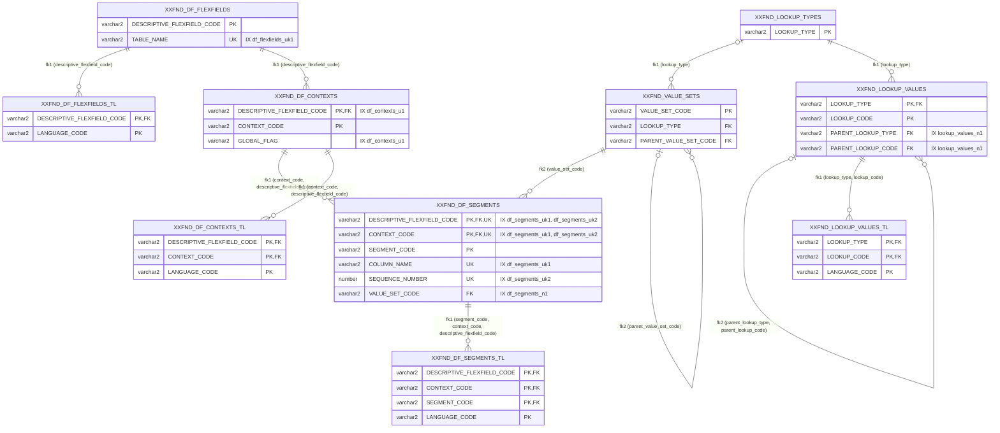
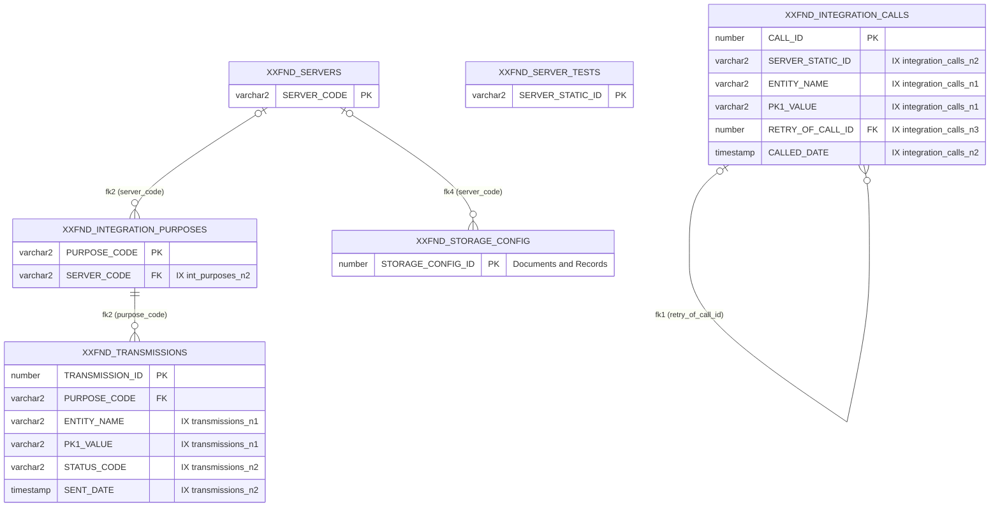

# COMMON data model (ERD)

Release 88, schema XXFUSION: the 74 COMMON tables, each with **only its primary key, foreign key, unique and indexed columns**
(every other column is left out). Read from the data dictionary of a database installed and upgraded by the release scripts.
PK = primary key, FK = foreign key, UK = unique key; "IX ..." names the non-primary-key indexes a column is part of.
A table of another module appears with its primary key only (its module in quotes). A line `||` means the foreign key
is mandatory, `o|` optional.

## Contents
- [Overview](#overview)
- [Platform](#platform)
- [Security](#security)
- [Reference Data](#reference-data)
- [Documents and Records](#documents-and-records)
- [Workflow](#workflow)
- [Integrations](#integrations)

## Overview

Every table and every foreign key (tables without a foreign key stand alone).

```mermaid
erDiagram
    XXFND_LOOKUP_TYPES ||--o{ XXFND_VALUE_SETS : ""
    XXFND_LOOKUP_TYPES ||--o{ XXFND_LOOKUP_VALUES : ""
    XXFND_LOOKUP_VALUES ||--o{ XXFND_LOOKUP_VALUES : ""
    XXFND_LOOKUP_VALUES ||--o{ XXFND_LOOKUP_VALUES_TL : ""
    XXFND_EMPLOYEES ||--o{ XXFND_USER_ROLES : ""
    XXFND_EMPLOYEES ||--o{ XXFND_USERS : ""
    XXFND_ROLES ||--o{ XXFND_SOD_RULES : ""
    XXFND_ROLES ||--o{ XXFND_TASK_SETTINGS : ""
    XXFND_ROLES ||--o{ XXFND_DATA_SECURITY_RULES : ""
    XXFND_ROLES ||--o{ XXFND_SOD_RULES : ""
    XXFND_ROLES ||--o{ XXFND_USER_ROLES : ""
    XXFND_ROLES ||--o{ XXFND_ROLE_PRIVILEGES : ""
    XXFND_ROLES ||--o{ XXFND_DATA_RULE_ASSIGNMENTS : ""
    XXFND_NOTIFICATION_TEMPLATES ||--o{ XXFND_NOTIFY_RULES : ""
    XXFND_NOTIFICATION_TEMPLATES ||--o{ XXFND_NOTIFICATION_TEMPLATES_TL : ""
    XXFND_NOTIFICATION_TEMPLATES ||--o{ XXFND_NOTIFY_EVENTS : ""
    XXFND_INTEGRATION_PURPOSES ||--o{ XXFND_TRANSMISSIONS : ""
    XXFND_DOCUMENT_ENTITIES ||--o{ XXFND_ATTACHMENT_BLK_ENTITIES : ""
    XXFND_DOCUMENT_ENTITIES ||--o{ XXFND_ATTACHED_DOCUMENTS : ""
    XXFND_DOCUMENT_ENTITIES ||--o{ XXFND_STORAGE_CONFIG : ""
    XXFND_DOCUMENT_ENTITIES ||--o{ XXFND_ENTITY_CONTAINERS : ""
    XXFND_DOCUMENT_ENTITIES ||--o{ XXFND_DOCUMENT_ENTITIES_TL : ""
    XXFND_DOCUMENT_CATEGORIES ||--o{ XXFND_DOC_CATEGORY_USAGES : ""
    XXFND_DOCUMENT_CATEGORIES ||--o{ XXFND_DOCUMENT_CATEGORIES_TL : ""
    XXFND_DOCUMENT_CATEGORIES ||--o{ XXFND_STORAGE_CONFIG : ""
    XXFND_DOCUMENT_CATEGORIES ||--o{ XXFND_ATTACHED_DOCUMENTS : ""
    XXFND_DOCUMENT_CATEGORIES ||--o{ XXFND_DOCUMENTS : ""
    XXFND_ATTACHMENT_FUNCTIONS ||--o{ XXFND_DOC_CATEGORY_USAGES : ""
    XXFND_ATTACHMENT_FUNCTIONS ||--o{ XXFND_ATTACHMENT_BLOCKS : ""
    XXFND_ATTACHMENT_BLOCKS ||--o{ XXFND_ATTACHMENT_BLK_ENTITIES : ""
    XXFND_STORAGE_CONFIG ||--o{ XXFND_ENTITY_CONTAINERS : ""
    XXFND_STORAGE_CONFIG ||--o{ XXFND_DOCUMENTS : ""
    XXFND_DOCUMENTS ||--o{ XXFND_DOCUMENTS : ""
    XXFND_DOCUMENTS ||--o{ XXFND_ATTACHED_DOCUMENTS : ""
    XXFND_DOCUMENTS ||--o{ XXFND_DOCUMENTS_TL : ""
    XXFND_VALUE_SETS ||--o{ XXFND_DF_SEGMENTS : ""
    XXFND_VALUE_SETS ||--o{ XXFND_VALUE_SETS : ""
    XXFND_DF_FLEXFIELDS ||--o{ XXFND_DF_FLEXFIELDS_TL : ""
    XXFND_DF_FLEXFIELDS ||--o{ XXFND_DF_CONTEXTS : ""
    XXFND_DF_CONTEXTS ||--o{ XXFND_DF_SEGMENTS : ""
    XXFND_DF_CONTEXTS ||--o{ XXFND_DF_CONTEXTS_TL : ""
    XXFND_DF_SEGMENTS ||--o{ XXFND_DF_SEGMENTS_TL : ""
    XXFND_APPLICATIONS ||--o{ XXFND_CONFIG_TABLES : ""
    XXFND_APPLICATIONS ||--o{ XXFND_FEATURES : ""
    XXFND_APPLICATIONS ||--o{ XXFND_ROLES : ""
    XXFND_APPLICATIONS ||--o{ XXFND_SETUP_TYPE_APPS : ""
    XXFND_APPLICATIONS ||--o{ XXFND_APPLICATION_FUNCTIONS : ""
    XXFND_APPLICATIONS ||--o{ XXFND_WORKFLOW_PROCESSES : ""
    XXFND_APPLICATIONS ||--o{ XXFND_APP_MENU_ENTRIES : ""
    XXFND_APPLICATIONS ||--o{ XXFND_CONTACT_SOURCES : ""
    XXFND_USERS ||--o{ XXFND_DATA_RULE_ASSIGNMENTS : ""
    XXFND_USERS ||--o{ XXFND_USER_ROLES : ""
    XXFND_FEATURES ||--o{ XXFND_APPLICATION_FUNCTIONS : ""
    XXFND_FEATURES ||--o{ XXFND_PRIVILEGES : ""
    XXFND_FEATURES ||--o{ XXFND_FEATURE_PAGES : ""
    XXFND_PRIVILEGES ||--o{ XXFND_ROLE_PRIVILEGES : ""
    XXFND_DATA_SECURITY_RULES ||--o{ XXFND_DATA_RULE_ASSIGNMENTS : ""
    XXFND_SETUP_TYPES ||--o{ XXFND_SETUP_TYPE_APPS : ""
    XXFND_INTEGRATION_CALLS ||--o{ XXFND_INTEGRATION_CALLS : ""
    XXFND_SERVERS ||--o{ XXFND_INTEGRATION_PURPOSES : ""
    XXFND_SERVERS ||--o{ XXFND_STORAGE_CONFIG : ""
    XXFND_COMMUNICATIONS ||--o{ XXFND_COMMUNICATIONS : ""
    XXFND_NOTIFY_CHANNELS ||--o{ XXFND_NOTIFY_RULES : ""
    XXFND_NOTIFY_CHANNELS ||--o{ XXFND_NOTIFICATIONS : ""
    XXFND_NOTIFY_EVENTS ||--o{ XXFND_NOTIFICATIONS : ""
    XXFND_NOTIFY_EVENTS ||--o{ XXFND_NOTIFY_RULES : ""
    XXFND_NOTIFY_RECIPIENT_TYPES ||--o{ XXFND_NOTIFY_RULES : ""
    XXFND_APPROVAL_TYPES ||--o{ XXFND_APPROVAL_TYPE_ATTRS : ""
    XXFND_APPROVAL_TYPES ||--o{ XXFND_APPROVAL_RULES : ""
    XXFND_APPROVAL_RULES ||--o{ XXFND_APPROVAL_RULE_STEPS : ""
    XXFND_APPROVAL_RULES ||--o{ XXFND_APPROVAL_RULE_CONDS : ""
    XXFND_APPROVAL_TXNS ||--o{ XXFND_APPROVAL_TXN_STEPS : ""
    XXFND_RFIS ||--o{ XXFND_RFI_ROUNDS : ""
    XXFND_AUDIT_LOG {
        number AUDIT_LOG_ID PK
    }
    XXFND_DOCUMENT_FILES {
        number FILE_ID PK
    }
    XXFND_DROPPED_OBJECTS {
    }
    XXFND_ERROR_LOG {
        number ERROR_ID PK
    }
    XXFND_MESSAGES {
        varchar2 MESSAGE_CODE PK
        varchar2 LANGUAGE_CODE PK
    }
    XXFND_RETENTION_POLICIES {
        number RETENTION_POLICY_ID PK
    }
    XXFND_SCHEMA_RELEASES {
        varchar2 RELEASE_CODE PK
    }
    XXFND_SERVER_TESTS {
        varchar2 SERVER_STATIC_ID PK
    }
    XXFND_TASK_ALERTS {
        number TASK_ID PK
        varchar2 ALERT_TYPE PK
    }
    XXFND_WF_DELEGATIONS {
        number DELEGATION_ID PK
    }
```

## Platform

9 tables. Other modules referenced: CONFIG_TABLES, CONTACT_SOURCES, FEATURES, ROLES, WORKFLOW_PROCESSES.

```mermaid
erDiagram
    XXFND_APPLICATIONS {
        number APPLICATION_ID PK
        varchar2 APPLICATION_CODE UK "IX applications_uk1"
        varchar2 APEX_APP_ALIAS UK "IX applications_uk2"
    }
    XXFND_APPLICATION_FUNCTIONS {
        varchar2 APPLICATION_CODE PK, FK
        varchar2 FEATURE_CODE PK, FK
    }
    XXFND_APP_MENU_ENTRIES {
        varchar2 APPLICATION_CODE PK, FK
        varchar2 ENTRY_CODE PK
    }
    XXFND_SETUP_TYPES {
        varchar2 SETUP_TYPE_CODE PK
    }
    XXFND_SETUP_TYPE_APPS {
        varchar2 SETUP_TYPE_CODE PK, FK
        varchar2 APPLICATION_CODE PK, FK
    }
    XXFND_MESSAGES {
        varchar2 MESSAGE_CODE PK
        varchar2 LANGUAGE_CODE PK
    }
    XXFND_ERROR_LOG {
        number ERROR_ID PK
        timestamp ERROR_TIME "IX error_log_n1"
    }
    XXFND_SCHEMA_RELEASES {
        varchar2 RELEASE_CODE PK
    }
    XXFND_DROPPED_OBJECTS {
    }
    XXFND_CONFIG_TABLES {
        varchar2 TABLE_NAME PK "Workflow"
    }
    XXFND_CONTACT_SOURCES {
        varchar2 ENTITY_NAME PK "Workflow"
    }
    XXFND_FEATURES {
        varchar2 FEATURE_CODE PK "Security"
    }
    XXFND_ROLES {
        varchar2 ROLE_CODE PK "Security"
    }
    XXFND_WORKFLOW_PROCESSES {
        varchar2 APPLICATION_CODE PK, FK "Workflow"
        varchar2 PROCESS_CODE PK "Workflow"
    }
    XXFND_APPLICATIONS ||--o{ XXFND_CONFIG_TABLES : "fk1 (application_id)"
    XXFND_APPLICATIONS o|--o{ XXFND_FEATURES : "fk1 (application_id)"
    XXFND_APPLICATIONS o|--o{ XXFND_ROLES : "fk1 (application_id)"
    XXFND_APPLICATIONS ||--o{ XXFND_SETUP_TYPE_APPS : "fk2 (application_code)"
    XXFND_APPLICATIONS ||--o{ XXFND_APPLICATION_FUNCTIONS : "fk1 (application_code)"
    XXFND_APPLICATIONS ||--o{ XXFND_WORKFLOW_PROCESSES : "fk1 (application_code)"
    XXFND_APPLICATIONS ||--o{ XXFND_APP_MENU_ENTRIES : "fk1 (application_code)"
    XXFND_APPLICATIONS ||--o{ XXFND_CONTACT_SOURCES : "fk1 (application_code)"
    XXFND_FEATURES ||--o{ XXFND_APPLICATION_FUNCTIONS : "fk2 (feature_code)"
    XXFND_SETUP_TYPES ||--o{ XXFND_SETUP_TYPE_APPS : "fk1 (setup_type_code)"
```

| Table | Indexes (columns) |
|---|---|
| XXFND_APPLICATIONS | applications_pk (application_id); applications_uk1 (application_code); applications_uk2 (apex_app_alias) |
| XXFND_APPLICATION_FUNCTIONS | application_functions_pk (application_code, feature_code) |
| XXFND_APP_MENU_ENTRIES | app_menu_entries_pk (application_code, entry_code) |
| XXFND_SETUP_TYPES | setup_types_pk (setup_type_code) |
| XXFND_SETUP_TYPE_APPS | setup_type_apps_pk (setup_type_code, application_code) |
| XXFND_MESSAGES | messages_pk (message_code, language_code) |
| XXFND_ERROR_LOG | error_log_n1 (error_time); error_log_pk (error_id) |
| XXFND_SCHEMA_RELEASES | schema_releases_pk (release_code) |
| XXFND_DROPPED_OBJECTS | - |

## Security

12 tables. Other modules referenced: APPLICATIONS, APPLICATION_FUNCTIONS, TASK_SETTINGS.

```mermaid
erDiagram
    XXFND_FEATURES {
        varchar2 FEATURE_CODE PK
        number APPLICATION_ID FK
    }
    XXFND_FEATURE_PAGES {
        varchar2 APP_ALIAS PK
        number PAGE_ID PK
        varchar2 FEATURE_CODE FK
    }
    XXFND_PRIVILEGES {
        varchar2 PRIVILEGE_CODE PK
        varchar2 FEATURE_CODE FK, UK "IX privileges_uk1"
        varchar2 ACTION_CODE UK "IX privileges_uk1"
    }
    XXFND_ROLES {
        varchar2 ROLE_CODE PK
        varchar2 APPLICATION_CODE "IX roles_n1"
        number APPLICATION_ID FK "IX roles_n2"
    }
    XXFND_ROLE_PRIVILEGES {
        varchar2 ROLE_CODE PK, FK
        varchar2 PRIVILEGE_CODE PK, FK
    }
    XXFND_USERS {
        number USER_ID PK
        varchar2 USER_NAME UK "IX users_uk1"
        number EMPLOYEE_ID FK, UK "IX users_uk2"
    }
    XXFND_USER_ROLES {
        number USER_ROLE_ID PK
        number EMPLOYEE_ID FK "IX user_roles_n1"
        varchar2 ROLE_CODE FK "IX user_roles_n2, user_roles_u2"
        date END_DATE_ACTIVE "IX user_roles_u2"
        number USER_ID FK "IX user_roles_n3, user_roles_u2"
    }
    XXFND_EMPLOYEES {
        number EMPLOYEE_ID PK
        number FUSION_PERSON_ID "IX employees_u3"
        varchar2 USER_NAME UK "IX employees_uk1"
        varchar2 EMAIL_ADDRESS UK "IX employees_uk2"
    }
    XXFND_DATA_SECURITY_RULES {
        number RULE_ID PK
        varchar2 ROLE_CODE FK "IX data_security_rules_u2"
        varchar2 TABLE_NAME "IX data_security_rules_u2"
        varchar2 RULE_TYPE "IX data_security_rules_u2"
        varchar2 COLUMN_NAME "IX data_security_rules_u2"
        varchar2 VALUE_LIST "IX data_security_rules_u2"
    }
    XXFND_DATA_RULE_ASSIGNMENTS {
        number ASSIGNMENT_ID PK
        number RULE_ID FK "IX data_rule_assign_u1"
        number USER_ID FK "IX data_rule_assign_n1, data_rule_assign_u1"
        varchar2 ROLE_CODE FK "IX data_rule_assign_n2, data_rule_assign_u1"
    }
    XXFND_SOD_RULES {
        number SOD_RULE_ID PK
        varchar2 ROLE_CODE_1 FK, UK "IX sod_rules_uk1"
        varchar2 ROLE_CODE_2 FK, UK "IX sod_rules_uk1"
        varchar2 CONFLICT_SCOPE UK "IX sod_rules_uk1"
    }
    XXFND_AUDIT_LOG {
        number AUDIT_LOG_ID PK
        varchar2 TABLE_NAME "IX audit_log_n1"
        varchar2 PK_VALUE "IX audit_log_n1"
        timestamp CHANGED_DATE "IX audit_log_n2"
    }
    XXFND_APPLICATIONS {
        number APPLICATION_ID PK "Platform"
    }
    XXFND_APPLICATION_FUNCTIONS {
        varchar2 APPLICATION_CODE PK, FK "Platform"
        varchar2 FEATURE_CODE PK, FK "Platform"
    }
    XXFND_TASK_SETTINGS {
        varchar2 TASK_DEFINITION PK "Workflow"
    }
    XXFND_EMPLOYEES o|--o{ XXFND_USER_ROLES : "fk1 (employee_id)"
    XXFND_EMPLOYEES o|--o{ XXFND_USERS : "fk1 (employee_id)"
    XXFND_ROLES ||--o{ XXFND_SOD_RULES : "fk1 (role_code_1)"
    XXFND_ROLES o|--o{ XXFND_TASK_SETTINGS : "fk1 (escalation_role_code)"
    XXFND_ROLES o|--o{ XXFND_DATA_SECURITY_RULES : "fk1 (role_code)"
    XXFND_ROLES ||--o{ XXFND_SOD_RULES : "fk2 (role_code_2)"
    XXFND_ROLES ||--o{ XXFND_USER_ROLES : "fk2 (role_code)"
    XXFND_ROLES ||--o{ XXFND_ROLE_PRIVILEGES : "fk1 (role_code)"
    XXFND_ROLES o|--o{ XXFND_DATA_RULE_ASSIGNMENTS : "fk3 (role_code)"
    XXFND_APPLICATIONS o|--o{ XXFND_FEATURES : "fk1 (application_id)"
    XXFND_APPLICATIONS o|--o{ XXFND_ROLES : "fk1 (application_id)"
    XXFND_USERS o|--o{ XXFND_DATA_RULE_ASSIGNMENTS : "fk2 (user_id)"
    XXFND_USERS o|--o{ XXFND_USER_ROLES : "fk3 (user_id)"
    XXFND_FEATURES ||--o{ XXFND_APPLICATION_FUNCTIONS : "fk2 (feature_code)"
    XXFND_FEATURES ||--o{ XXFND_PRIVILEGES : "fk1 (feature_code)"
    XXFND_FEATURES ||--o{ XXFND_FEATURE_PAGES : "fk1 (feature_code)"
    XXFND_PRIVILEGES ||--o{ XXFND_ROLE_PRIVILEGES : "fk2 (privilege_code)"
    XXFND_DATA_SECURITY_RULES ||--o{ XXFND_DATA_RULE_ASSIGNMENTS : "fk1 (rule_id)"
```

| Table | Indexes (columns) |
|---|---|
| XXFND_FEATURES | features_pk (feature_code) |
| XXFND_FEATURE_PAGES | feature_pages_pk (app_alias, page_id) |
| XXFND_PRIVILEGES | privileges_pk (privilege_code); privileges_uk1 (feature_code, action_code) |
| XXFND_ROLES | roles_n1 (application_code); roles_n2 (application_id); roles_pk (role_code) |
| XXFND_ROLE_PRIVILEGES | role_privileges_pk (role_code, privilege_code) |
| XXFND_USERS | users_pk (user_id); users_uk1 (user_name); users_uk2 (employee_id) |
| XXFND_USER_ROLES | user_roles_n1 (employee_id); user_roles_n2 (role_code); user_roles_n3 (user_id); user_roles_pk (user_role_id); user_roles_u2 (end_date_active, user_id, role_code) |
| XXFND_EMPLOYEES | employees_pk (employee_id); employees_u3 (fusion_person_id); employees_uk1 (user_name); employees_uk2 (email_address) |
| XXFND_DATA_SECURITY_RULES | data_security_rules_pk (rule_id); data_security_rules_u2 (role_code, table_name, rule_type, column_name, value_list) |
| XXFND_DATA_RULE_ASSIGNMENTS | data_rule_assign_n1 (user_id); data_rule_assign_n2 (role_code); data_rule_assign_pk (assignment_id); data_rule_assign_u1 (rule_id, user_id, role_code) |
| XXFND_SOD_RULES | sod_rules_pk (sod_rule_id); sod_rules_uk1 (role_code_1, role_code_2, conflict_scope) |
| XXFND_AUDIT_LOG | audit_log_n1 (table_name, pk_value); audit_log_n2 (changed_date); audit_log_pk (audit_log_id) |

## Reference Data

10 tables.

| Table | Indexes (columns) |
|---|---|
| XXFND_LOOKUP_TYPES | lookup_types_pk (lookup_type) |
| XXFND_LOOKUP_VALUES | lookup_values_n1 (parent_lookup_type, parent_lookup_code); lookup_values_pk (lookup_type, lookup_code) |
| XXFND_LOOKUP_VALUES_TL | lookup_values_tl_pk (lookup_type, lookup_code, language_code) |
| XXFND_VALUE_SETS | value_sets_pk (value_set_code) |
| XXFND_DF_FLEXFIELDS | df_flexfields_pk (descriptive_flexfield_code); df_flexfields_uk1 (table_name) |
| XXFND_DF_FLEXFIELDS_TL | df_flexfields_tl_pk (descriptive_flexfield_code, language_code) |
| XXFND_DF_CONTEXTS | df_contexts_pk (descriptive_flexfield_code, context_code); df_contexts_u1 (global_flag, descriptive_flexfield_code) |
| XXFND_DF_CONTEXTS_TL | df_contexts_tl_pk (descriptive_flexfield_code, context_code, language_code) |
| XXFND_DF_SEGMENTS | df_segments_n1 (value_set_code); df_segments_pk (descriptive_flexfield_code, context_code, segment_code); df_segments_uk1 (descriptive_flexfield_code, context_code, column_name); df_segments_uk2 (descriptive_flexfield_code, context_code, sequence_number) |
| XXFND_DF_SEGMENTS_TL | df_segments_tl_pk (descriptive_flexfield_code, context_code, segment_code, language_code) |

## Documents and Records

15 tables. Other modules referenced: SERVERS.

```mermaid
erDiagram
    XXFND_DOCUMENT_ENTITIES {
        varchar2 ENTITY_NAME PK
    }
    XXFND_DOCUMENT_ENTITIES_TL {
        varchar2 ENTITY_NAME PK, FK
        varchar2 LANGUAGE_CODE PK
    }
    XXFND_DOCUMENT_CATEGORIES {
        varchar2 CATEGORY_CODE PK
    }
    XXFND_DOCUMENT_CATEGORIES_TL {
        varchar2 CATEGORY_CODE PK, FK
        varchar2 LANGUAGE_CODE PK
    }
    XXFND_DOCUMENTS {
        number DOCUMENT_ID PK
        varchar2 CATEGORY_CODE FK "IX documents_n1"
        number BASE_DOCUMENT_ID FK "IX documents_n2"
        number STORAGE_CONFIG_ID FK
    }
    XXFND_DOCUMENTS_TL {
        number DOCUMENT_ID PK, FK
        varchar2 LANGUAGE_CODE PK
    }
    XXFND_DOCUMENT_FILES {
        number FILE_ID PK
    }
    XXFND_ATTACHED_DOCUMENTS {
        number ATTACHED_DOCUMENT_ID PK
        number DOCUMENT_ID FK "IX attached_documents_n2"
        varchar2 ENTITY_NAME FK "IX attached_documents_n1"
        varchar2 PK1_VALUE "IX attached_documents_n1"
        varchar2 PK2_VALUE "IX attached_documents_n1"
        varchar2 PK3_VALUE "IX attached_documents_n1"
        varchar2 CATEGORY_CODE FK
    }
    XXFND_ATTACHMENT_FUNCTIONS {
        varchar2 FUNCTION_CODE PK
        varchar2 APEX_APP_ALIAS UK "IX att_functions_uk1"
        number APEX_PAGE_ID UK "IX att_functions_uk1"
    }
    XXFND_ATTACHMENT_BLOCKS {
        varchar2 FUNCTION_CODE PK, FK, UK "IX att_blocks_uk1"
        varchar2 BLOCK_CODE PK
        varchar2 REGION_STATIC_ID UK "IX att_blocks_uk1"
    }
    XXFND_ATTACHMENT_BLK_ENTITIES {
        varchar2 FUNCTION_CODE PK, FK
        varchar2 BLOCK_CODE PK, FK
        varchar2 ENTITY_NAME PK, FK
    }
    XXFND_DOC_CATEGORY_USAGES {
        varchar2 FUNCTION_CODE PK, FK
        varchar2 CATEGORY_CODE PK, FK
    }
    XXFND_ENTITY_CONTAINERS {
        number ENTITY_CONTAINER_ID PK
        varchar2 ENTITY_NAME FK, UK "IX entity_containers_uk1"
        varchar2 PK1_VALUE UK "IX entity_containers_uk1"
        number STORAGE_CONFIG_ID FK, UK "IX entity_containers_uk1"
    }
    XXFND_STORAGE_CONFIG {
        number STORAGE_CONFIG_ID PK
        varchar2 ENTITY_NAME FK
        varchar2 CATEGORY_CODE FK "IX storage_config_u2"
        varchar2 ENABLED_FLAG "IX storage_config_u2"
        varchar2 APPLICATION_CODE "IX storage_config_u2"
        varchar2 SERVER_CODE FK "IX storage_config_n1"
    }
    XXFND_RETENTION_POLICIES {
        number RETENTION_POLICY_ID PK
        varchar2 TABLE_NAME "IX retention_policies_u1"
        varchar2 JURISDICTION "IX retention_policies_u1"
    }
    XXFND_SERVERS {
        varchar2 SERVER_CODE PK "Integrations"
    }
    XXFND_DOCUMENT_ENTITIES ||--o{ XXFND_ATTACHMENT_BLK_ENTITIES : "fk2 (entity_name)"
    XXFND_DOCUMENT_ENTITIES ||--o{ XXFND_ATTACHED_DOCUMENTS : "fk2 (entity_name)"
    XXFND_DOCUMENT_ENTITIES o|--o{ XXFND_STORAGE_CONFIG : "fk1 (entity_name)"
    XXFND_DOCUMENT_ENTITIES ||--o{ XXFND_ENTITY_CONTAINERS : "fk1 (entity_name)"
    XXFND_DOCUMENT_ENTITIES ||--o{ XXFND_DOCUMENT_ENTITIES_TL : "fk1 (entity_name)"
    XXFND_DOCUMENT_CATEGORIES ||--o{ XXFND_DOC_CATEGORY_USAGES : "fk2 (category_code)"
    XXFND_DOCUMENT_CATEGORIES ||--o{ XXFND_DOCUMENT_CATEGORIES_TL : "fk1 (category_code)"
    XXFND_DOCUMENT_CATEGORIES o|--o{ XXFND_STORAGE_CONFIG : "fk2 (category_code)"
    XXFND_DOCUMENT_CATEGORIES ||--o{ XXFND_ATTACHED_DOCUMENTS : "fk3 (category_code)"
    XXFND_DOCUMENT_CATEGORIES ||--o{ XXFND_DOCUMENTS : "fk1 (category_code)"
    XXFND_ATTACHMENT_FUNCTIONS ||--o{ XXFND_DOC_CATEGORY_USAGES : "fk1 (function_code)"
    XXFND_ATTACHMENT_FUNCTIONS ||--o{ XXFND_ATTACHMENT_BLOCKS : "fk1 (function_code)"
    XXFND_ATTACHMENT_BLOCKS ||--o{ XXFND_ATTACHMENT_BLK_ENTITIES : "fk1 (block_code, function_code)"
    XXFND_STORAGE_CONFIG ||--o{ XXFND_ENTITY_CONTAINERS : "fk2 (storage_config_id)"
    XXFND_STORAGE_CONFIG o|--o{ XXFND_DOCUMENTS : "fk3 (storage_config_id)"
    XXFND_DOCUMENTS o|--o{ XXFND_DOCUMENTS : "fk2 (base_document_id)"
    XXFND_DOCUMENTS ||--o{ XXFND_ATTACHED_DOCUMENTS : "fk1 (document_id)"
    XXFND_DOCUMENTS ||--o{ XXFND_DOCUMENTS_TL : "fk1 (document_id)"
    XXFND_SERVERS o|--o{ XXFND_STORAGE_CONFIG : "fk4 (server_code)"
```

| Table | Indexes (columns) |
|---|---|
| XXFND_DOCUMENT_ENTITIES | doc_entities_pk (entity_name) |
| XXFND_DOCUMENT_ENTITIES_TL | doc_entities_tl_pk (entity_name, language_code) |
| XXFND_DOCUMENT_CATEGORIES | doc_categories_pk (category_code) |
| XXFND_DOCUMENT_CATEGORIES_TL | doc_categories_tl_pk (category_code, language_code) |
| XXFND_DOCUMENTS | documents_n1 (category_code); documents_n2 (base_document_id); documents_pk (document_id) |
| XXFND_DOCUMENTS_TL | documents_tl_pk (document_id, language_code) |
| XXFND_DOCUMENT_FILES | document_files_pk (file_id) |
| XXFND_ATTACHED_DOCUMENTS | attached_documents_n1 (entity_name, pk1_value, pk2_value, pk3_value); attached_documents_n2 (document_id); attached_documents_pk (attached_document_id) |
| XXFND_ATTACHMENT_FUNCTIONS | att_functions_pk (function_code); att_functions_uk1 (apex_app_alias, apex_page_id) |
| XXFND_ATTACHMENT_BLOCKS | att_blocks_pk (function_code, block_code); att_blocks_uk1 (function_code, region_static_id) |
| XXFND_ATTACHMENT_BLK_ENTITIES | att_blk_entities_pk (function_code, block_code, entity_name) |
| XXFND_DOC_CATEGORY_USAGES | doc_category_usages_pk (function_code, category_code) |
| XXFND_ENTITY_CONTAINERS | entity_containers_pk (entity_container_id); entity_containers_uk1 (entity_name, pk1_value, storage_config_id) |
| XXFND_STORAGE_CONFIG | storage_config_n1 (server_code); storage_config_pk (storage_config_id); storage_config_u2 (enabled_flag, application_code, category_code) |
| XXFND_RETENTION_POLICIES | retention_policies_pk (retention_policy_id); retention_policies_u1 (table_name, jurisdiction) |

## Workflow

23 tables. Other modules referenced: APPLICATIONS, ROLES.

```mermaid
erDiagram
    XXFND_WORKFLOW_PROCESSES {
        varchar2 APPLICATION_CODE PK, FK
        varchar2 PROCESS_CODE PK
    }
    XXFND_TASK_SETTINGS {
        varchar2 TASK_DEFINITION PK
        varchar2 ESCALATION_ROLE_CODE FK
    }
    XXFND_TASK_ALERTS {
        number TASK_ID PK
        varchar2 ALERT_TYPE PK
    }
    XXFND_WF_DELEGATIONS {
        number DELEGATION_ID PK
        varchar2 DELEGATOR_USER_NAME "IX wf_delegations_n1"
        date START_DATE "IX wf_delegations_n1"
        date END_DATE "IX wf_delegations_n1"
    }
    XXFND_CONFIG_TABLES {
        varchar2 TABLE_NAME PK
        number APPLICATION_ID FK
    }
    XXFND_APPROVAL_TYPES {
        varchar2 APPROVAL_TYPE_CODE PK
    }
    XXFND_APPROVAL_TYPE_ATTRS {
        varchar2 APPROVAL_TYPE_CODE PK, FK
        varchar2 ATTRIBUTE_CODE PK
    }
    XXFND_APPROVAL_RULES {
        number RULE_ID PK
        varchar2 APPROVAL_TYPE_CODE FK, UK "IX approval_rules_uk1"
        varchar2 RULE_NAME UK "IX approval_rules_uk1"
    }
    XXFND_APPROVAL_RULE_CONDS {
        number CONDITION_ID PK
        number RULE_ID FK, UK "IX approval_rule_conds_uk1"
        varchar2 ATTRIBUTE_CODE UK "IX approval_rule_conds_uk1"
        varchar2 ATTRIBUTE_VALUE UK "IX approval_rule_conds_uk1"
    }
    XXFND_APPROVAL_RULE_STEPS {
        number RULE_STEP_ID PK
        number RULE_ID FK, UK "IX approval_rule_steps_uk1"
        number STEP_NO UK "IX approval_rule_steps_uk1"
    }
    XXFND_APPROVAL_TXNS {
        varchar2 APPROVAL_TYPE_CODE PK
        varchar2 TXN_ID PK
    }
    XXFND_APPROVAL_TXN_STEPS {
        varchar2 APPROVAL_TYPE_CODE PK, FK
        varchar2 TXN_ID PK, FK
        number STEP_SEQ PK
    }
    XXFND_RFIS {
        number RFI_ID PK
        varchar2 RFI_NUMBER UK "IX rfis_uk1"
        varchar2 APPLICATION_CODE "IX rfis_n1"
        varchar2 ENTITY_NAME "IX rfis_n1"
        varchar2 PK1_VALUE "IX rfis_n1"
        varchar2 RECIPIENT_USER_NAME "IX rfis_n2"
        varchar2 RESPONSE_TOKEN_HASH "IX rfis_u2"
    }
    XXFND_RFI_ROUNDS {
        number RFI_ID PK, FK
        number ROUND_NO PK
    }
    XXFND_NOTIFY_EVENTS {
        varchar2 EVENT_CODE PK
        varchar2 TEMPLATE_CODE FK "IX notify_events_n1"
        varchar2 TRIGGER_CODE "IX notify_events_u1"
        varchar2 OUTCOME_CODE "IX notify_events_u1"
    }
    XXFND_NOTIFY_CHANNELS {
        varchar2 CHANNEL_CODE PK
    }
    XXFND_NOTIFY_RECIPIENT_TYPES {
        varchar2 RECIPIENT_TYPE_CODE PK
    }
    XXFND_NOTIFY_RULES {
        number RULE_ID PK
        varchar2 EVENT_CODE FK "IX notify_rules_u1"
        varchar2 APPLICATION_CODE "IX notify_rules_u1"
        varchar2 PROCESS_CODE "IX notify_rules_u1"
        varchar2 RECIPIENT_TYPE_CODE FK "IX notify_rules_n1, notify_rules_u1"
        varchar2 RECIPIENT_VALUE "IX notify_rules_u1"
        varchar2 CHANNEL_CODE FK "IX notify_rules_n2, notify_rules_u1"
        varchar2 TEMPLATE_CODE FK "IX notify_rules_n3"
    }
    XXFND_NOTIFICATION_TEMPLATES {
        varchar2 TEMPLATE_CODE PK
    }
    XXFND_NOTIFICATION_TEMPLATES_TL {
        varchar2 TEMPLATE_CODE PK, FK
        varchar2 LANGUAGE_CODE PK
    }
    XXFND_NOTIFICATIONS {
        number NOTIFICATION_ID PK
        varchar2 EVENT_CODE FK "IX notifications_n2"
        varchar2 CHANNEL_CODE FK "IX notifications_n1, notifications_n4"
        varchar2 USER_NAME "IX notifications_n1"
        number TASK_ID "IX notifications_n3"
        timestamp READ_DATE "IX notifications_n1"
    }
    XXFND_COMMUNICATIONS {
        number COMMUNICATION_ID PK
        varchar2 ENTITY_NAME "IX communications_n1"
        varchar2 PK1_VALUE "IX communications_n1"
        number RFI_ID "IX communications_n2"
        number IN_REPLY_TO_ID FK "IX communications_n3"
    }
    XXFND_CONTACT_SOURCES {
        varchar2 ENTITY_NAME PK
        varchar2 APPLICATION_CODE FK
    }
    XXFND_APPLICATIONS {
        number APPLICATION_ID PK "Platform"
    }
    XXFND_ROLES {
        varchar2 ROLE_CODE PK "Security"
    }
    XXFND_ROLES o|--o{ XXFND_TASK_SETTINGS : "fk1 (escalation_role_code)"
    XXFND_NOTIFICATION_TEMPLATES o|--o{ XXFND_NOTIFY_RULES : "fk4 (template_code)"
    XXFND_NOTIFICATION_TEMPLATES ||--o{ XXFND_NOTIFICATION_TEMPLATES_TL : "fk1 (template_code)"
    XXFND_NOTIFICATION_TEMPLATES ||--o{ XXFND_NOTIFY_EVENTS : "fk1 (template_code)"
    XXFND_APPLICATIONS ||--o{ XXFND_CONFIG_TABLES : "fk1 (application_id)"
    XXFND_APPLICATIONS ||--o{ XXFND_WORKFLOW_PROCESSES : "fk1 (application_code)"
    XXFND_APPLICATIONS ||--o{ XXFND_CONTACT_SOURCES : "fk1 (application_code)"
    XXFND_COMMUNICATIONS o|--o{ XXFND_COMMUNICATIONS : "fk1 (in_reply_to_id)"
    XXFND_NOTIFY_CHANNELS ||--o{ XXFND_NOTIFY_RULES : "fk3 (channel_code)"
    XXFND_NOTIFY_CHANNELS ||--o{ XXFND_NOTIFICATIONS : "fk2 (channel_code)"
    XXFND_NOTIFY_EVENTS ||--o{ XXFND_NOTIFICATIONS : "fk1 (event_code)"
    XXFND_NOTIFY_EVENTS ||--o{ XXFND_NOTIFY_RULES : "fk1 (event_code)"
    XXFND_NOTIFY_RECIPIENT_TYPES ||--o{ XXFND_NOTIFY_RULES : "fk2 (recipient_type_code)"
    XXFND_APPROVAL_TYPES ||--o{ XXFND_APPROVAL_TYPE_ATTRS : "fk1 (approval_type_code)"
    XXFND_APPROVAL_TYPES ||--o{ XXFND_APPROVAL_RULES : "fk1 (approval_type_code)"
    XXFND_APPROVAL_RULES ||--o{ XXFND_APPROVAL_RULE_STEPS : "fk1 (rule_id)"
    XXFND_APPROVAL_RULES ||--o{ XXFND_APPROVAL_RULE_CONDS : "fk1 (rule_id)"
    XXFND_APPROVAL_TXNS ||--o{ XXFND_APPROVAL_TXN_STEPS : "fk1 (txn_id, approval_type_code)"
    XXFND_RFIS ||--o{ XXFND_RFI_ROUNDS : "fk1 (rfi_id)"
```

| Table | Indexes (columns) |
|---|---|
| XXFND_WORKFLOW_PROCESSES | workflow_processes_pk (application_code, process_code) |
| XXFND_TASK_SETTINGS | task_settings_pk (task_definition) |
| XXFND_TASK_ALERTS | task_alerts_pk (task_id, alert_type) |
| XXFND_WF_DELEGATIONS | wf_delegations_n1 (delegator_user_name, start_date, end_date); wf_delegations_pk (delegation_id) |
| XXFND_CONFIG_TABLES | config_tables_pk (table_name) |
| XXFND_APPROVAL_TYPES | approval_types_pk (approval_type_code) |
| XXFND_APPROVAL_TYPE_ATTRS | approval_type_attrs_pk (approval_type_code, attribute_code) |
| XXFND_APPROVAL_RULES | approval_rules_pk (rule_id); approval_rules_uk1 (approval_type_code, rule_name) |
| XXFND_APPROVAL_RULE_CONDS | approval_rule_conds_pk (condition_id); approval_rule_conds_uk1 (rule_id, attribute_code, attribute_value) |
| XXFND_APPROVAL_RULE_STEPS | approval_rule_steps_pk (rule_step_id); approval_rule_steps_uk1 (rule_id, step_no) |
| XXFND_APPROVAL_TXNS | approval_txns_pk (approval_type_code, txn_id) |
| XXFND_APPROVAL_TXN_STEPS | approval_txn_steps_pk (approval_type_code, txn_id, step_seq) |
| XXFND_RFIS | rfis_n1 (application_code, entity_name, pk1_value); rfis_n2 (recipient_user_name); rfis_pk (rfi_id); rfis_u2 (response_token_hash); rfis_uk1 (rfi_number) |
| XXFND_RFI_ROUNDS | rfi_rounds_pk (rfi_id, round_no) |
| XXFND_NOTIFY_EVENTS | notify_events_n1 (template_code); notify_events_pk (event_code); notify_events_u1 (trigger_code, outcome_code) |
| XXFND_NOTIFY_CHANNELS | notify_channels_pk (channel_code) |
| XXFND_NOTIFY_RECIPIENT_TYPES | notify_rcpt_types_pk (recipient_type_code) |
| XXFND_NOTIFY_RULES | notify_rules_n1 (recipient_type_code); notify_rules_n2 (channel_code); notify_rules_n3 (template_code); notify_rules_pk (rule_id); notify_rules_u1 (event_code, application_code, process_code, recipient_type_code, recipient_value, channel_code) |
| XXFND_NOTIFICATION_TEMPLATES | notif_templates_pk (template_code) |
| XXFND_NOTIFICATION_TEMPLATES_TL | notif_templates_tl_pk (template_code, language_code) |
| XXFND_NOTIFICATIONS | notifications_n1 (user_name, channel_code, read_date); notifications_n2 (event_code); notifications_n3 (task_id); notifications_n4 (channel_code); notifications_pk (notification_id) |
| XXFND_COMMUNICATIONS | communications_n1 (entity_name, pk1_value); communications_n2 (rfi_id); communications_n3 (in_reply_to_id); communications_pk (communication_id) |
| XXFND_CONTACT_SOURCES | contact_sources_pk (entity_name) |

## Integrations

5 tables. Other modules referenced: STORAGE_CONFIG.

| Table | Indexes (columns) |
|---|---|
| XXFND_SERVERS | servers_pk (server_code) |
| XXFND_SERVER_TESTS | server_tests_pk (server_static_id) |
| XXFND_INTEGRATION_PURPOSES | int_purposes_n2 (server_code); int_purposes_pk (purpose_code) |
| XXFND_INTEGRATION_CALLS | integration_calls_n1 (entity_name, pk1_value); integration_calls_n2 (server_static_id, called_date); integration_calls_n3 (retry_of_call_id); integration_calls_pk (call_id) |
| XXFND_TRANSMISSIONS | transmissions_n1 (entity_name, pk1_value); transmissions_n2 (status_code, sent_date); transmissions_pk (transmission_id) |
