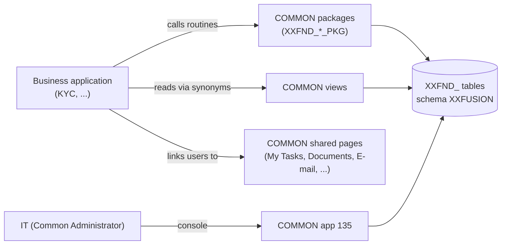

# COMMON Application Guide

Oct 17, 2026 · Mazhar Hussain

Live version: https://claude.ai/code/artifact/2dea5e75-7edf-4d65-9d9f-64b865aad68e

## What COMMON is

COMMON is the shared platform every business application builds on: one place for security, setup data, documents, workflow, notifications and integrations, so no application builds them again. It is APEX application 135 (alias COMMON, schema XXFUSION, workspace XXCUS) and is at release 89.

- **For IT:** one console to register applications, give access, maintain shared setup and watch every application.
- **For business users:** one inbox (My Tasks), one notification list, one place for a record's documents and e-mails, whatever application raised them.
- **For developers:** ready routines and pages to call or link to, instead of writing their own tables and screens.

COMMON is organised in six modules. Each module holds components (features), and each component owns its tables, its package and its screens.

| Module | What it covers |
| --- | --- |
| Platform | Applications and their onboarding, application settings, optional features, platform activity, feedback, the data model |
| Security | Users, roles and privileges, data security (row-level rules), segregation of duties, the audit log |
| Reference Data | Lookups, value sets and descriptive flexfields |
| Documents and Records | Document entities and categories, attachment pages, document storage, retention |
| Workflow | Process catalogue, task deadlines, delegations, approval rules, configuration-change approvals, information requests, notifications, e-mails |
| Integrations | Workspace servers, integration purposes, the call log |



An application never writes COMMON's tables: it calls COMMON's routines, reads its views through synonyms, and links its users to COMMON's shared pages.

## The components

COMMON has 26 components. Each one has a user-guide video (see Reference); the Screens column gives its COMMON page numbers.

| Component | Module | What it does | Screens |
| --- | --- | --- | --- |
| Applications | Platform | Registers applications, chooses the common functions each one manages itself, defines setup types | 160 list, 165 Application Journey, 166 application page, 162-164 |
| Application Settings | Platform | Changes the APEX application settings of the running application | 10022, 10023 |
| Optional Features | Platform | Switches an application's optional features (build options) on or off | 10020, 10021 |
| Platform Activity | Platform | Page views, top users, errors and slowest pages of every application | 170 |
| Usage and Feedback | Platform | The feedback people gave in any application, and its follow-up | 171, 172 |
| Give Feedback | Platform | Everyone gives feedback on the page they are on, in any application | 173 (navigation bar) |
| Data Model | Platform | The database objects and entity-relationship diagram of every application, read live from the dictionary | 175 objects, 176 one object, 177 diagram |
| Users & Access | Security | Users (local or single sign-on), their roles and data access rules | 103, 104, 183 |
| Roles & Privileges | Security | Roles, their View / Create / Manage privileges per feature, segregation of duties | 105-108, 182 |
| Data Security | Security | Row-level rules: which rows each user and role can see | 180, 181 |
| Audit Log | Security | Who changed what and when | 111 |
| Lookups | Reference Data | Lists of values with translations and levels | 101, 102 |
| Flexfields | Reference Data | Descriptive flexfields, contexts, segments and value sets | 150-153 |
| Attachments | Documents and Records | Document entities and categories, attachment pages, storage per application and category | 130-137 |
| Documents | Documents and Records | The documents of any application's record: add, view, replace | 47, 48 |
| Retention | Documents and Records | How long records and documents are kept | 112, 113 |
| Workflow Setup | Workflow | Process catalogue (which workflows are on), task deadlines and escalation, delegations | 114, 115, 145-147 |
| Approval Setup | Workflow | Approval types and rules: conditions, steps, approvers | 148, 149 |
| Configuration Change Approvals | Workflow | Maker-checker on setup data: a change waits for approval | 144 (from My Tasks) |
| Information Requests | Workflow | Asking a colleague or an outside person for information on a record, with the answer loop | 143, public page 50 |
| My Tasks | Workflow | The signed-in user's tasks and notifications from every application | 40, 43 |
| Workflow Monitor | Workflow | Every running workflow and task: suspend, resume, retry, reassign | 141, 142 |
| Notifications | Workflow | Templates, delivery rules (e-mail, in-app, push) and the notification log | 109, 110, 116, 117 |
| Communications | Workflow | The e-mails of a record: send, record a received one, history | 45, 46 |
| Integrations | Integrations | Workspace servers, integration purposes, the call log | 120-125 |
| Common Home | Platform | The landing page with the modules a user may open | 1 |

## Who uses COMMON and what they see

Three kinds of people use COMMON, and each sees only what their role allows. Every page needs a privilege (View, Create or Manage of its feature), and data security filters the rows.

| Who | How they get in | What they see |
| --- | --- | --- |
| IT (Common Administrator) | Signs in to COMMON | Every module and every application; the application selector narrows the setup screens to one application |
| An application's administrators | From their own application's menu, once IT sets the function to "managed in the application" (Applications > the application) | Only that function's screens, and only their own application's setup rows plus the shared ones |
| Business users | Any signed-in user, from links in their application | The shared pages (My Tasks, Notifications, Communications, E-mail, Documents, Information Request, Configuration Change, Give Feedback), with only their own tasks and the records they may see |

Two rules decide what data anyone sees:

- **Setup data is visible per application.** Lookups, flexfields, document categories, attachment pages, approval rules, templates, roles and menu entries belong to one application. An application and its administrators see their own rows plus COMMON's shared rows; IT sees all.
- **Transaction data is visible per user.** Tasks, notifications, documents, information requests and e-mails show each user what they may see, from every application. My Tasks lists a user's tasks of all applications in one place.

## Installing and upgrading COMMON

COMMON ships as one file, `COMMON-Application-APEXlang_<release>.zip`, which holds the application and its database scripts (Supporting Objects). The same steps install and upgrade it; an upgrade keeps all data, and running it again changes nothing. Always install or upgrade COMMON before any application that uses it.

1. **App Builder > Import** the zip over application 135 with **Parsing Schema = XXCUS** and **Install Supporting Objects = No**.
2. **Edit Application Definition > Security > Database Session > Parsing Schema = XXFUSION**, then Apply Changes.
3. **Utilities > Supporting Objects > Install Supporting Objects.** The first script checks XXFUSION's privileges; if one is missing it stops with ORA-20900 and lists the exact grant statements for ADMIN to run. Run them, then install again.
4. **Once, for Data Model (release 89):** ADMIN runs `apex/db/admin/grant-dictionary-to-xxfusion.sql` (read-only access to the dictionary views). On Autonomous Database, if that is refused, ADMIN runs `grant select any dictionary to xxfusion;` instead. Then run Install Supporting Objects again, so Data Model shows every application's schema.
5. **Sign in.** The installing user is the first Common Administrator; give the role COMMON\_ADMIN to the IT administrators.

Settings IT controls after install (Shared Components > Application Settings):

- **ONBOARD\_SELF\_ALLOWED** (default Y): set to N to stop applications from registering themselves from their own install.
- **MAIL\_FROM / MAIL\_FOOTER**: the sender and footer of COMMON's e-mails (APEX e-mail must be configured).

Each release's notes and patch folder are in `apex/install/COMMON/INSTALL.md` and `apex/patches/`.

## Onboarding an application

An application can use COMMON only after it is registered (onboarded). Registration records its APEX application, alias and schema; grants its schema SELECT, REFERENCES and EXECUTE on COMMON's objects; creates the role `<CODE>_ADMIN`; and makes its menu entries. There are three ways in, and all three can be re-run safely.

| Way | Who runs it | When to use it |
| --- | --- | --- |
| **Application Journey** (COMMON page 165) | IT | The full setup in one guided flow: roles, users, shared functions, setup types, processes, notifications, document storage, integrations, review, Register |
| **Script** `apex/db/admin/onboard-application.sql` (as XXFUSION) | IT / DBA | A scripted registration with the basic setup |
| **Self-onboarding** script `00c-onboard-with-common.sql` in the application's own install | The application's installer | The bare minimum during the application's install: checks COMMON, registers the application, creates the synonyms. Optional install-wizard values: ONBOARD\_APP\_CODE and ONBOARD\_ADMIN\_USER. IT can switch it off with ONBOARD\_SELF\_ALLOWED = N |

After registration, the application page (COMMON 166) shows every section with Add / Edit / Remove, Disable / Enable, and Delete. Delete works only when the application is disabled and no business data refers to it; the setup it registered is removed with it.

**The application menu.** Each registered application gets menu entries for the common functions: My Tasks, Notifications, Shared Setup, Give Feedback, and one entry per common function it manages. IT shows or hides them in Applications > the application > Menu in the Application, and the application can add its own with `XXFND_APPLICATION_PKG.REGISTER_MENU_ENTRY`. The application's navigation list is one query:

```sql
select * from xxfnd_app_menu_v where app_alias = :APP_ALIAS order by display_sequence
```

## Guidelines for developers of other applications

Build only what is specific to your business; use COMMON for everything shared. These rules hold for every application, and COMMON enforces most of them in the database.

1. **Never duplicate a COMMON component.** No copied screen, package logic, list of values, authorization scheme, workflow, task or setup table. If COMMON lacks something or has a bug, list it for the COMMON team in `apex/COMMON-ISSUES.md` with its details, and wait for the fix; never work around it with a copy.
2. **Change COMMON data only through COMMON routines.** Never INSERT, UPDATE, DELETE or MERGE into an `XXFND_` table. Your schema has SELECT, REFERENCES and EXECUTE only, so direct writes fail with a privilege error. If no routine exists, list the gap in COMMON-ISSUES.
3. **Pass your application to every data-changing routine.** Each routine takes the application code (`p_application_code`) and changes only that application's rows. COMMON checks who calls (ORA-20192 for another application's code) and refuses another application's rows (ORA-20186).
4. **Register your setup from your install.** Call the REGISTER\_\* routines from an idempotent install script (KYC: script 18h). A registration adds only what is missing, so an administrator's later change is kept. To retire something, call the matching UNREGISTER\_\* routine.
5. **Read through the synonyms and views.** Your install creates a synonym per granted COMMON object (script 00c does it). You see your own setup rows plus the shared ones, never another application's.
6. **Link to COMMON's shared pages, don't rebuild them.** Use "page in a different application" links (`app: COMMON`, same session) to My Tasks, Communications, E-mail, Attachments, Give Feedback and Information Request, passing the record's entity and key.
7. **One package per component.** Your request logic lives in your request package, your case logic in your case package. When you need another component's rule, call its routine; never copy it.
8. **No HTML in PL/SQL.** Build screens from APEX components fed by SQL (reports, cards, forms, template components). Packages return data, not markup; where no component can do the job, write the reason in a comment beside the code.
9. **Every page has two or more privileges plus data security.** Register your features with View, Create and Manage privileges, map your pages to them, and filter rows with data access rules. Access is given from the COMMON console, never in code.
10. **No install error, ever.** Base scripts create a table only when it is missing; every later change to an existing object is a checked step (ADD\_COLUMN, ADD\_CONSTRAINT, ENSURE\_INDEX …) in a later numbered script, so a re-run does nothing. Install or upgrade COMMON first, then your application.

## Using each component from your application

Each routine below takes your application code first. Register routines add what is missing and keep administrators' changes; each has an UNREGISTER\_\* partner that removes only your own rows (ORA-20196 while business data still uses a row).

| Component | Register from your install | Call at run time | Link to (COMMON page) |
| --- | --- | --- | --- |
| Applications | `XXFND_APPLICATION_PKG.REGISTER_MENU_ENTRY`; self-onboarding via script 00c | `PAGE_ALLOWED`, `IS_DELEGATED`; navigation list from `XXFND_APP_MENU_V` | Shared Setup (100) |
| Roles & Privileges | `XXFND_PRIVILEGE_PKG.REGISTER_FEATURE`, `REGISTER_PRIVILEGE`, `REGISTER_FEATURE_PAGE`, `REGISTER_ROLE`, `ADD_ROLE_PRIVILEGE`, `REGISTER_SOD_RULE` | `HAS_PRIVILEGE`, `HAS_PAGE_PRIVILEGE`, `HAS_ROLE` | - |
| Users & Access | - | `XXFND_USER_PKG` as your sign-in (post-authentication) and authorization logic | - |
| Data Security | `XXFND_VPD_PKG.REGISTER_DATA_RULE` | the policies filter rows by themselves | - |
| Lookups | `XXFND_LOOKUP_PKG.REGISTER_LOOKUP_TYPE`, `REGISTER_LOOKUP_VALUE` | `LOOKUP_MEANING`, `IS_VALID_LOOKUP`, the lookup views | - |
| Flexfields | `XXFND_DFF_PKG.REGISTER_VALUE_SET`, `REGISTER_FLEXFIELD`, `REGISTER_CONTEXT` | the flexfield runtime of XXFND\_DFF\_PKG | - |
| Attachments / Documents | `XXFND_ATTACH_PKG.REGISTER_ENTITY`, `REGISTER_CATEGORY`, `REGISTER_ATTACHMENT_PAGE` | `MOVE_DOCUMENTS`, `RECORD_VISIBLE` | Attachments (47) with the record's entity and key |
| Workflow Setup | `XXFND_WORKFLOW_PKG.REGISTER_TASK_SETTING`, `REGISTER_CONFIG_TABLE` | `START_PROCESS`, `STATE`, `END_PROCESS`, `WORKFLOW_ENABLED` | My Tasks (40) |
| Approval Setup | `XXFND_APPROVAL_RULE_PKG.REGISTER_TYPE`, `REGISTER_DEFAULT_RULE`, `REGISTER_RULE` | `START_APPROVAL`, `CURRENT_APPROVERS`, `NEXT_STEP`, `DECIDE_TASK` | - |
| Configuration Change Approvals | `XXFND_APPROVAL_PKG.REGISTER_CONFIG_TABLE` | `REQUEST` | Configuration Change (144) |
| Information Requests | - | `XXFND_RFI_PKG.CREATE_RFI`, `SEND_EMAIL`, `OPEN_COUNT`, `IS_WAITING` | Information Request (143); public answer page 50 |
| Notifications | `XXFND_NOTIFY_PKG.REGISTER_TEMPLATE` | `SEND`, `SEND_TO_USERS`, `RAISE_EVENT` | Notifications (43) |
| Communications | `XXFND_NOTIFY_PKG.REGISTER_CONTACT_SOURCE` (a view of your schema with PK1\_VALUE, CONTACT\_NAME, EMAIL\_ADDRESS, SELECT granted to COMMON) | `SEND_EMAIL`, `RECORD_SENT`, `RECORD_RECEIVED` | Communications (45), E-mail (46) |
| Integrations | `XXFND_INTEGRATION_PKG.REGISTER_PURPOSE` | `CALL`, `RETRY` | - |
| Give Feedback | - | - | Give Feedback (173) with &APP\_ID. and &APP\_PAGE\_ID. |
| Data Model | `XXFND_DATA_MODEL_PKG.REGISTER_TABLE_GROUP`; IT sets your object prefix | - | Data Model (175), from your menu when IT lets you manage it |

Every component folder in the repository (`repos/common/features/<component>/README.md`) gives its purpose, objects, privileges and these calls in full.

## Checklist for a new application

- [ ] COMMON is installed at the release your application needs (Platform > Applications shows it).
- [ ] Your application is registered: Application Journey, the onboarding script, or script 00c in your install.
- [ ] Your schema has its synonyms for the COMMON objects (script 00c creates them).
- [ ] Your install registers your features, privileges, pages, roles, lookups, flexfields, document entities, templates, approval types and rules with the REGISTER\_\* routines, and nothing writes an XXFND\_ table directly.
- [ ] Your navigation list reads `XXFND_APP_MENU_V`, and your pages link to COMMON's shared pages instead of copies.
- [ ] Every page has View plus Create or Manage privileges, and your tables have data access rules.
- [ ] Your install and upgrade pass a fresh install, a re-run, an upgrade and the App Builder import without an error.
- [ ] IT has set your object prefix in Data Model if your schema holds other applications' objects.

## Checklist for each release

- [ ] Install or upgrade COMMON first, then your application.
- [ ] Anything you no longer use is removed with its UNREGISTER\_\* routine.
- [ ] Anything COMMON is missing is listed in `apex/COMMON-ISSUES.md`, not built in your application.

## Open COMMON issues

| Issue | Effect | Workaround |
| --- | --- | --- |
| C7 | Another application's application settings cannot be changed from COMMON's Application Settings screen | Change them in App Builder (Shared Components > Application Settings) |
| C9 (part) | Task settings, segregation-of-duties and data rules, messages and retention policies have no UNREGISTER routine; an application's retention policy blocks its delete | IT removes them in the COMMON console |
| KYC adoption | KYC script 16l still writes COMMON's approval tables directly, which fails since release 88 | KYC is changed to call `REGISTER_RULE` in its next release |

## Reference

**User-guide videos.** There is one video per component (26 videos, 30 to 90 seconds each, 15 MB in total), recorded in COMMON release 89 as IT. Each opens with the component's purpose, walks through its screens with each page's help text as captions, and ends with how another application uses it. They have no sound. They are in `apex/docs/user-guide/videos/`, listed with their length in `apex/docs/user-guide/README.md`, and are re-recorded after a release with `python3 apex/tools/record_user_guide.py`.

| What | Where |
| --- | --- |
| Live object catalogue and diagram of any application | COMMON > Platform > Data Model (pages 175-177) |
| ERD of COMMON (key columns, by module) | `apex/COMMON-ERD.md` |
| Metadata of every COMMON object (columns, constraints, indexes, routines, grants, dependencies) | `apex/COMMON-METADATA.json` |
| One folder per component: README (purpose, objects, privileges, use from another application), pages, database objects | `repos/common/features/<component>/` |
| Dependencies between components, release by release | `apex/ARCHITECTURE.md` |
| Install and upgrade steps per release | `apex/install/COMMON/INSTALL.md`, `apex/patches/` |
| Issues listed for the COMMON team | `apex/COMMON-ISSUES.md` |
| Database scripts and their order | `apex/db/` and `apex/db/manifest.json` |
| COMMON application source (APEXlang) | `apex/src/database/xxfusion/apex_apps/f135` |
