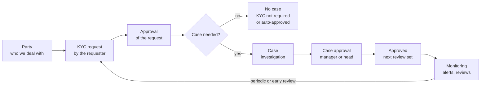

# KYC Application Guide

Oct 17, 2026 · Mazhar Hussain

Live version: https://claude.ai/code/artifact/f22c645c-074b-444d-aa56-f0a8e312084e

## What KYC is

The KYC Compliance Platform (APEX application 134, alias KYC, schema XXCUS) runs Know Your Customer and Know Your Business due diligence on every company and person the organisation deals with. It is at release 92.

- **Business teams** raise a KYC request when they want to work with a counterparty, and answer the questions Compliance sends back.
- **Compliance** investigates the counterparty in a case: screening, documents, ownership, source of funds and a risk tier. A second person approves the result.
- **Monitoring** keeps approved parties under review. A review starts automatically before it is due, and alerts flag events such as expiring documents or an adverse screening.

KYC holds only what is specific to due diligence: parties, requests, cases, KYC rules and monitoring. Everything shared comes from the COMMON application and is not built again in KYC: users and roles, data security, lookups, documents, workflow and approvals, My Tasks, e-mail and information requests. See *Shared functions from COMMON* below.

## Roles and what each sees

KYC registers five roles in COMMON. IT gives them to users in COMMON (Users & Access); nothing is granted in KYC itself. Every page needs a View, Create or Manage privilege of its feature, and data security limits the rows each user sees.

| Role | What the person does | Screens on a new install |
| --- | --- | --- |
| Requester | Raises KYC requests and answers requests for information | Home, KYC Requests (create and manage their own; their department's by data security) |
| Compliance Officer | Investigates cases, raises requests for information, proposes the risk tier | Home, Parties, KYC Requests, Cases (including case assignment), Monitoring |
| Compliance Manager | Approves cases and configuration changes (the second pair of eyes) | As Compliance Officer, plus the KYC rules, configuration-change approvals and the Executive Dashboard |
| Head of Compliance | Final approval of high-risk cases and suspicious activity report (SAR) decisions | As Compliance Manager, plus viewing the alert rules |
| System Administrator | Maintains the KYC setup | Home, the KYC rules and configuration-change approvals, Alert Rules, and COMMON's Workflow Monitor, Application Settings and Usage and Feedback. No case data |

These are the grants of a first install. IT can change them afterwards in COMMON (Roles & Privileges), and an upgrade keeps what IT decided.

Segregation of duties: on one case, the same person may not act as both Compliance Manager and Compliance Officer, both Compliance Officer and Requester, or both Head of Compliance and Requester.

## The end-to-end flow

1. **Party.** Every company or person is a party (Parties). A requester can also enter a new counterparty inside the request: it is created as a *Pending* party and approved with the request. Possible duplicates are shown as a warning, and Compliance can merge them.
2. **KYC request.** The requester fills in the four-step wizard (request and counterparty, party details, questionnaire, review and submit) and attaches the documents they have. *Save as Draft* keeps it for later.
3. **Approval of the request.** On Submit, the request follows its approval path from COMMON (Approval Setup). Each approver checks the request and its documents (the document checklist) from their task in My Tasks: Approve, Reject, Request Information (the request goes back to the requester as *Pending Information*), or Merge a duplicate party.
4. **Is a case needed?** When the last step approves, the scored questionnaire decides the intake outcome: *KYC not required*, *Auto-approved*, or *Assigned to Compliance*. For the first two the request is closed without a case; for the last, a case opens and the approver can assign the officer straight away. Periodic and early reviews always go to Compliance.
5. **Case.** The Compliance Officer works through the case sections: summary, party, contacts and ownership, screening (registry, sanctions, PEP, adverse media), documents, risk assessment, source of funds, notes and requests for information. A confirmed match or a PEP puts the case into Enhanced KYC. The officer then submits it on *Review and Submit*.
6. **Case approval.** A Compliance Manager approves or rejects; high-risk cases and suspicious activity report (SAR) decisions go to the Head of Compliance. A closed case has a printable Compliance Report and, if needed, an FIU report.
7. **Approved party and monitoring.** The risk tier sets the next review: Low after 36 months, Medium after 24, High after 12. The watchlist shows when each review is due. A periodic review starts automatically ahead of the due date, and an alert or a reassessment can start an early one. Either way the review is a new request through the same flow.

## Using each screen

Each KYC component has a user-guide video showing its screens, with each page's own help text as captions. The three flow videos (create, approval, cases) follow one new request from the requester to the approved case.

| Component | Pages | Who uses it | What you do there | Video |
| --- | --- | --- | --- | --- |
| Home | 1 | Everyone | See what waits for you as tiles (open requests, pending information, pending approval, open and overdue cases, open RFIs) and your tasks | home.mp4 |
| Parties | 20 list, 21 party, 24 and 25 party wizard, 22 contacts, 23 owners and officers, 26 identity checks, 27 registry checks | Compliance | Maintain each counterparty once: identity, contacts, ownership, documents; merge duplicates | parties.mp4 |
| KYC Requests: create | 200 list, 201, 204, 202, 203 wizard, 205 request | Requester | Raise a request: counterparty, details, questionnaire, documents, submit; follow it and answer questions | create-request.mp4 |
| KYC Requests: approval | 206 approval screen | Approvers of the request | Check the request and its documents; approve, reject, request information, merge a duplicate; assign the case | request-approval.mp4 |
| Cases | 210 workbench, 211 case, 213 screening, 215 document check, 216 create case, 218 source of funds, 217 Compliance Report, 219 FIU report | Compliance Officer, Compliance Manager, Head of Compliance | Investigate section by section, submit for approval; approvers decide in review mode | cases.mp4 |
| KYC Rules | 160 to 162 questionnaires, 163 and 164 conclusion templates, 165 approval matrix, 167 risk model, 138 and 139 document rules | Compliance Manager, Head of Compliance, System Administrator | Maintain the rules (see *Setting up the KYC rules*) | kyc-rules.mp4 |
| Monitoring | 220 watchlist, 221 alerts, 222 reassessment | Compliance | Follow review due dates and alerts; start an early review | monitoring.mp4 |
| Alert Rules | 225, 226 | System Administrator (Head of Compliance views) | Set what the daily monitoring run watches | alert-rules.mp4 |
| Executive Dashboard | 230 | Compliance Manager, Head of Compliance | See open requests and cases, SLA and review backlog, decisions and the risk profile | dashboard.mp4 |

## Setting up the KYC rules

The rules are business setup, maintained by the Compliance Manager, the Head of Compliance or the System Administrator (KYC Rules privilege). Changes to scoring, document rules and the risk model are maker-checker: a second person approves each change in My Tasks before it applies, and every case keeps the values it was scored with.

| Setup | Page | What it controls |
| --- | --- | --- |
| Questionnaires and questions | 160, 161, 162 | The requester questionnaire is scored and routes the request (KYC not required, auto-approved or a case). Its thresholds turn the total score into a risk tier. The officer questionnaire is unscored and records findings. |
| Conclusion templates | 163, 164 | The pre-filled conclusion of the Compliance Report for each risk tier. |
| Approval matrix | 165 | For each risk tier, whether a case must record its SAR decision before approval (Enhanced KYC always does). Who approves is set in COMMON, Approval Setup. |
| Risk model | 167 | The factors, the country lists (FATF black and grey lists, company list) and the tier thresholds with their review intervals. The impact of pending changes is shown before they are approved. |
| Mandatory document rules | 138, 139 | The checklist of required documents by jurisdiction and entity type. Only approved rules apply. |
| Alert rules | 225, 226 | What the daily monitoring run watches: reviews coming due or overdue, investigations past their SLA, party documents expiring, adverse screenings after approval. Maintained by the System Administrator. |

The KYC parameters (case SLA days, PEP review months, review lead days) are application settings, changed in COMMON's Application Settings.

## Shared functions from COMMON

KYC opens these COMMON screens in the same session; they look and work the same in every application. Their user-guide videos are in `apex/docs/user-guide/videos/` and are described in the COMMON Application Guide.

| What you do | COMMON screen | Video |
| --- | --- | --- |
| Decide approval tasks, answer requests for information, see notifications | My Tasks (40), Notifications (43) | my-tasks.mp4 |
| Add, view or replace a request's or case's documents | Attachments (47) | documents.mp4 |
| E-mail a counterparty and keep the e-mail history of a record | Communications (45), E-mail (46) | communications.mp4 |
| Ask a colleague or an outside person for information on a case | Information Request (143); outside people answer on public page 50 | information-requests.mp4 |
| Approve a change to the KYC rules (maker-checker) | Configuration Change (144), from My Tasks | change-approvals.mp4 |
| Give feedback on the page you are on | Give Feedback (173) | give-feedback.mp4 |
| Users, roles, data access, approval rules, lookups, application settings (IT and the KYC administrators) | COMMON console: Users & Access, Roles & Privileges, Data Security, Approval Setup, Lookups, Application Settings | users-access.mp4, roles-privileges.mp4, data-security.mp4, approval-setup.mp4, lookups.mp4, app-settings.mp4 |

## Reference

**User-guide videos.** There are nine KYC videos, 6 MB in total, recorded on KYC release 92 with COMMON release 89 and the test users REQ1, OFFICER1, MGR1 and HOC1. They have no sound. They are in `apex/docs/user-guide/kyc/videos/` and are listed in `apex/docs/user-guide/kyc/README.md`. Re-record them after a release with `python3 apex/tools/record_kyc_user_guide.py`.

| Video | Length | Signed in as |
| --- | --- | --- |
| home.mp4 | 0:40 | REQ1, then OFFICER1 |
| parties.mp4 | 1:03 | OFFICER1 |
| create-request.mp4 | 1:55 | REQ1 |
| request-approval.mp4 | 1:22 | OFFICER1 |
| cases.mp4 | 2:46 | OFFICER1, then MGR1 |
| kyc-rules.mp4 | 1:20 | MGR1 |
| monitoring.mp4 | 0:46 | MGR1 |
| alert-rules.mp4 | 0:42 | HOC1 |
| dashboard.mp4 | 0:25 | MGR1 |

**Issues found while recording, now fixed:**

| Issue | Was | Fixed in |
| --- | --- | --- |
| COMMON C12 | COMMON's My Tasks opened a KYC task page (206, 211) without a checksum ("Session state protection violation") | COMMON 90 (patch 103) |
| KYC 16l | On COMMON 88 and later the KYC install could not create its approval rules (direct writes to COMMON) | KYC 93 (patch 104): COMMON's REGISTER\_\* routines |
| KYC tests | Six KYC tests wrote COMMON tables directly | KYC 93 (patch 104): COMMON routines, plus a test-only helper where COMMON has no routine yet (C13, C14) |

| What | Where |
| --- | --- |
| KYC application source (APEXlang) | `apex/src/database/xxcus/apex_apps/f134` |
| KYC install and upgrade steps | `apex/install/KYC/INSTALL.md` |
| One folder per KYC component | `repos/kyc/features/<component>/` |
| Dependencies between components | `apex/ARCHITECTURE.md` |
| COMMON guide and its videos | `apex/docs/user-guide/COMMON-GUIDE.md`, `apex/docs/user-guide/videos/` |
| Issues listed for the COMMON team | `apex/COMMON-ISSUES.md` |
