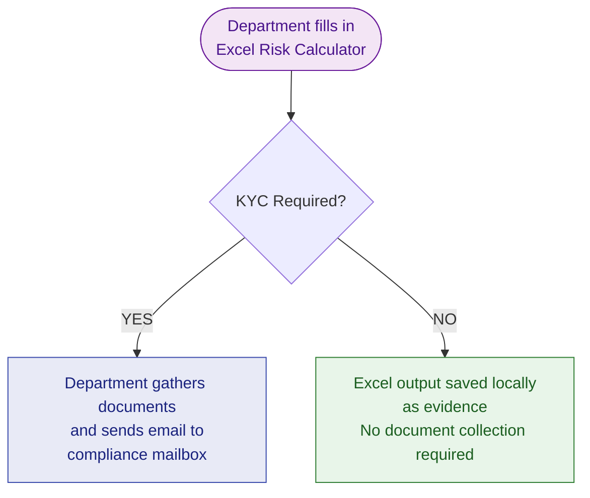
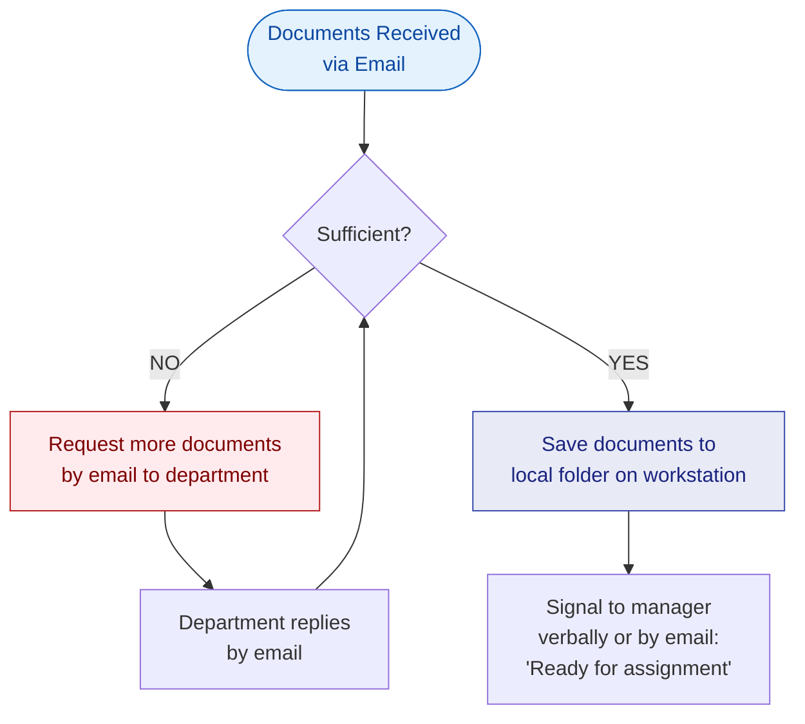
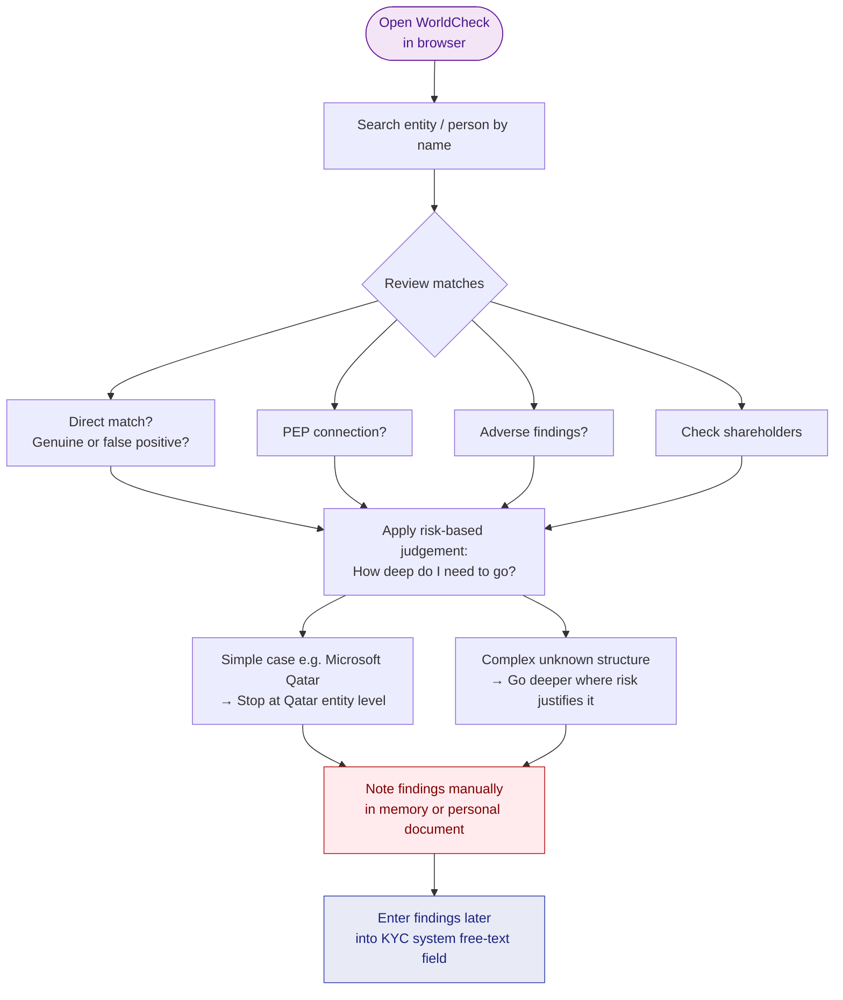
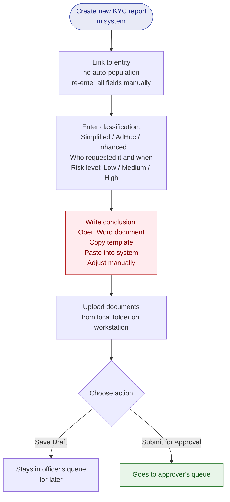
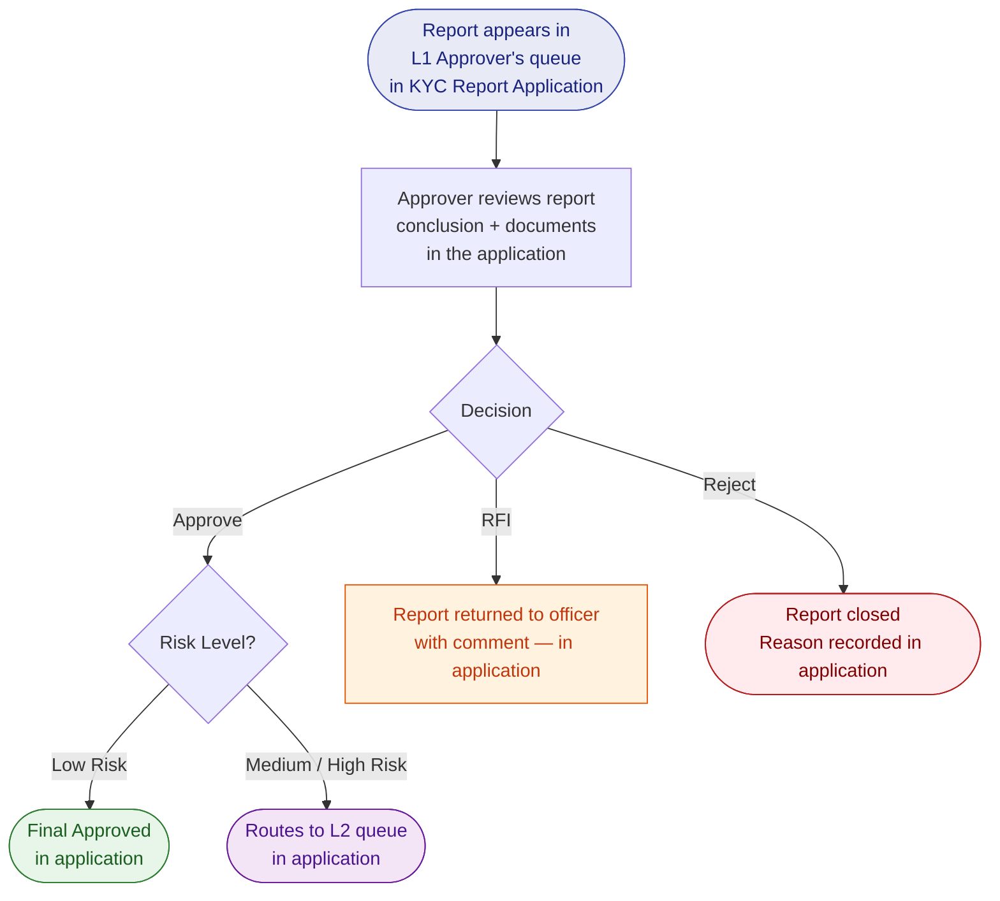
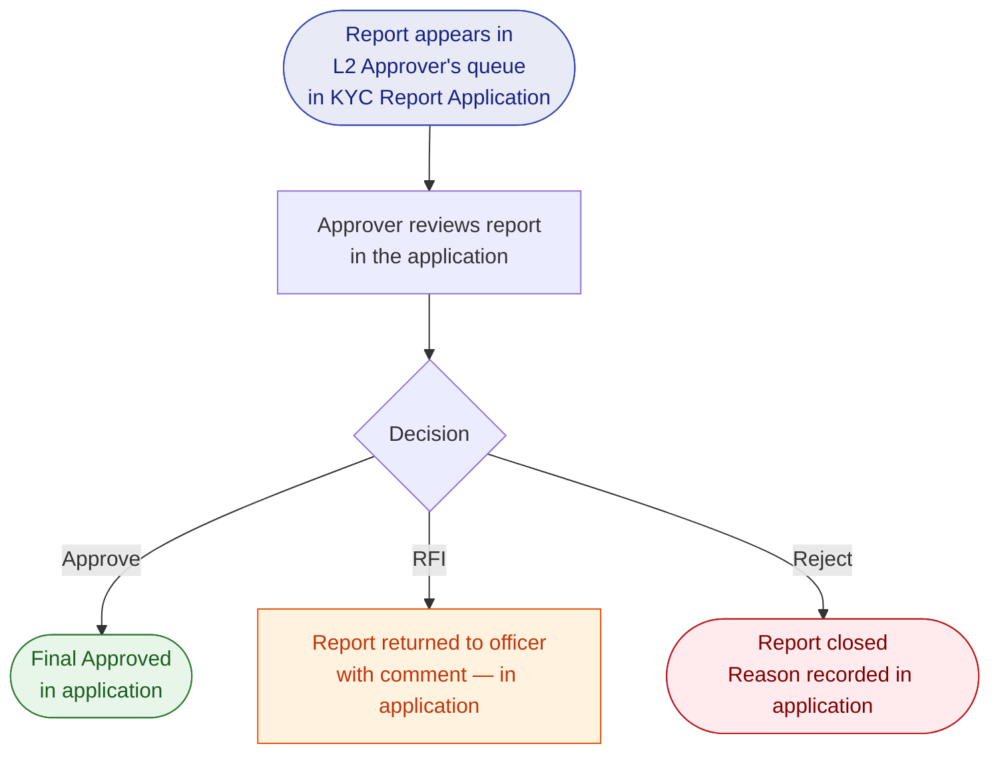

# Version 2 — Business Process Guide
# How We Work Today: The As-Is KYC Process

**Document Type:** Business Process Guide  
**Audience:** Compliance Team, Management  
**Source:** Requirements Gathering Session — Head of Enterprise Risk & Compliance  
**Status:** Current manual process — basis for all future improvements  

> *This document faithfully captures how the compliance team currently operates — including every manual step, every tool used, and every known difficulty. It is not a criticism; it is an honest baseline from which to improve.*

---

## Overview

Today, the KYC process at Qatari Diar is a **mixed manual and semi-digital process**. The KYC management system handles the formal approval steps, but everything before and after — receiving requests, validating documents, storing files, communicating with requestors, and reporting on results — is managed through email, Excel spreadsheets, and individual judgment.

This creates real risks: inconsistency between departments, reliance on personal memory, difficulty onboarding new staff, and no reliable way to answer basic management questions like "how many KYC reports did we complete this quarter?" without first requesting a data export.

---

## Who Is Involved

| Person | Role | Tools Used |
|---|---|---|
| **Business Department** (e.g., Procurement, Sales, Egypt office) | Identifies the need, runs initial check, submits documents | Excel Risk Calculator, Email |
| **Compliance Officer** (Hessa, Latifa, and others) | Validates documents, conducts research, creates reports | WorldCheck, KYC System, Local folders, Email |
| **Compliance Manager / Head** (Carlos) | Assigns work, manages pipeline, approves reports | Email, KYC System, Excel |

---

## Phase 0: Deciding Whether a KYC is Needed

**Who does this:** The business department that wants to engage a new counterparty

Before the compliance team is even involved, the requesting department runs a check using an **Excel-based Risk Calculator**. This spreadsheet was built to match QD's internal KYC policy and asks a series of questions about the counterparty:

- Who are they? (a company or an individual)
- Where are they from? (Qatari, majority-Qatari, minority-Qatari, foreign)
- What type of relationship does QD plan to have with them? (supplier, buyer, tenant, investor, etc.)
- Is there any financial involvement, current or proposed?
- Are there any known connections to related parties?

Based on the answers, the Excel says either **"KYC Required"** or **"KYC Not Required"**.

!!! warning "What goes wrong here"
    - No formal evidence record when KYC is not required — just files on someone's laptop
    - The Excel can be manually changed — output depends on the person filling it in
    - Requests arrive in different formats from different departments — no standard

**What goes wrong here:**
- Different departments send requests in completely different formats — there is no standard
- When KYC is not required, the supporting documents are saved locally but there is no formal evidence record that the check was done
- The Excel can be changed manually, so the output depends on the honesty and judgment of the person filling it in

---

## Phase 1: Receiving and Validating Documents

**Who does this:** Compliance Officer

The compliance team receives an email in their shared mailbox. The email contains the Risk Calculator and attached documents. The officer opens everything and checks whether the documentation is sufficient to conduct proper due diligence.

**What "sufficient" means:**

For an **individual person**: A government-issued photo ID (Qatar ID or passport) is generally enough.

For a **company**: The officer needs an official document that shows — clearly and completely — who owns the company and who controls it. In Qatar, a Commercial Registration (CR) usually does this. In other countries (Egypt, UK, Tajikistan), different documents serve this purpose — so there is no single fixed checklist.

What the officer is always looking for is: *"Can I trace the ownership all the way to a real person?"*

**What goes wrong here:**
- Everything is tracked in email threads — there is no system record of how many rounds of back-and-forth happened
- Documents are saved to the officer's local workstation. At the end of the day, they must be manually moved to a QDocs folder — but there is no check for whether a folder for that entity already exists, and no standard naming convention
- New staff (e.g., Hessa) have no way to know if a report has been done before for the same entity. Institutional knowledge lives only in people's memories

---

## Phase 2: Assigning the Work

**Who does this:** Compliance Manager

The manager looks at who is available (not on leave, not overloaded) and assigns the case to a compliance officer. This is done verbally or by email — there is no assignment record in the system.

**What goes wrong here:**
- If the Level 2 Approver is unavailable, a substitute must be manually activated by phone — there is no system to handle this
- There is no workload view to see how many active cases each officer has

---

## Phase 3: Conducting the Due Diligence (WorldCheck)

**Who does this:** Compliance Officer

Once assigned, the officer opens **WorldCheck** — an external international database — in their web browser. This is a separate tool, entirely disconnected from the KYC system.

For each entity and each significant individual (UBO), the officer:
1. Searches by name
2. Reviews the results for matches
3. Determines whether a match is genuine or a false positive
4. Notes whether the entity or person is a PEP (Politically Exposed Person) — for example, a state-owned company is connected to the government, which counts as a PEP link
5. Looks at shareholders and connected entities

**What goes wrong here:**
- There is no structured way to record what was found — it goes into a free-text field in the system later
- There is no record of *when* the screening was done or *which databases* were checked
- The officer carries the findings in their head until they sit down to enter them into the system

---

## Phase 4: Recording the Entity in the System

**Who does this:** Compliance Officer

The officer logs into the KYC system and creates an **Entity** record for the counterparty, entering all the details from their research. For companies, they add each UBO and authorised signatory as a separate sub-record.

**What goes wrong here:**
- The system does not check whether this entity was already recorded before. If the same company was screened six months ago, the officer won't know unless they remember or happen to search
- Screening results go into a single free-text box — there is no structure for recording the date, the source, whether it was a match or not, or whether the person is a PEP
- Date fields (like date of birth) accept any text — the system will happily accept "12-0-2024" or "32/13/2025" without warning

---

## Phase 5: Creating the KYC Report

**Who does this:** Compliance Officer

Next, the officer creates the formal KYC report in the system. This involves entering many fields that could theoretically be pre-filled from the entity record — but the system requires re-entering them from scratch.

One particular pain point: the **final conclusion**. Around 95% of the time, the conclusion follows a standard template. But those templates are stored in Word documents on shared drives, not in the system. The officer opens Word, copies the relevant template, pastes it into the system, and adjusts it.

**What goes wrong here:**
- The request date field has no validation — an officer under pressure might inadvertently enter a wrong year and not notice
- The system does not warn when the entered date does not match the actual chronology of events
- Documents must be uploaded from the local workstation — they cannot be linked from QDocs

---

## Phase 6: Level 1 Approval

**Who does this:** Level 1 Approver (currently Latifa)

**Where this happens:** Inside the **KYC Report Application** (the existing JSF system). The approver logs into the application and sees the submitted report in their approval queue.

The approver reviews the full report, reads the conclusion, checks the attached documents, and then acts directly in the application:

- **Approve** — satisfied with the work; status moves to Approved (L1)
- **Request For Information (RFI)** — something is unclear; sends the report back to the officer with a comment recorded in the application
- **Reject** — the report is closed with a stated reason recorded in the application

**Approval routing by risk (handled by the application):**
- **Low risk** → Level 1 approval is the final approval — report status moves to Final Approved
- **Medium or High risk** → report automatically routes to Level 2 queue

---

## Phase 7: Level 2 Approval (Medium/High Risk Only)

**Who does this:** Level 2 Approver / Head of Compliance (Carlos)

**Where this happens:** Inside the **KYC Report Application** — the report appears in Carlos's queue after L1 approval.

Same actions as Level 1 — full review inside the application, then Approve / RFI / Reject. Once approved at Level 2, the report status is set to Final Approved in the application.

**What should happen but doesn't:**  
The requesting department should automatically receive the completed report and a notification that the KYC is done. Currently, this does not happen — someone on the compliance team has to remember to email them.

---

## Phase 8: Reporting and Tracking

**Current reality:**

There is no live dashboard. When management needs to know:
- How many KYCs were completed this month?
- How long is our average turnaround time?
- Which cases are overdue?

The answer is always: *"Madi, send me an export."* A data extract is requested, downloaded to Excel, and manually analysed.

Additionally, there is no system to flag when a previously approved KYC is due for periodic review. This is managed — imperfectly — by memory and the manager's judgment.

---

## Process Status Labels (Current)

The compliance team informally categorises their pipeline using these statuses — some are in the system, some exist only in email folder labels:

| Status | Where It Lives | Meaning |
|---|---|---|
| In Progress | Email / memory | Officer actively working on it |
| Waiting for More Information | Email flag | Documents requested from department |
| Waiting for Approval | KYC System | Report submitted, in approver's queue |
| Draft | KYC System | Saved but not yet submitted |
| Submitted | KYC System | Sent to Level 1 |
| Approved (L1) | KYC System | Passed Level 1 review |
| Approved (Final) | KYC System | All approvals complete |
| Rejected | KYC System | Closed — not proceeding |
| RFI | KYC System | Information requested by approver |

---

## Summary of Known Problems

| Problem | Consequence |
|---|---|
| No standard intake form — requests arrive by email in any format | Officers spend time decoding inconsistent submissions |
| Documents saved locally, moved manually to QDocs | Risk of loss, no naming standard, no institutional memory |
| No duplicate entity detection | Same company screened multiple times with no link |
| Screening results are free text with no structure | Cannot audit what was checked or when |
| Date fields accept invalid values | KPI data is unreliable |
| Conclusion writing requires external Word document | Slow, inconsistent, error-prone |
| No approver delegation | Approvals stall when approver is absent |
| No completion notification | Requestors don't know when KYC is done |
| No live KPI reporting | Management can only view data through manual exports |
| System has no source code | If it breaks, it cannot be fixed — urgent risk |
