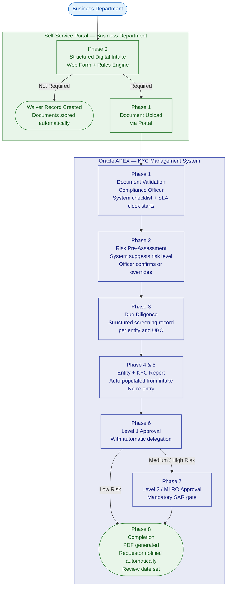
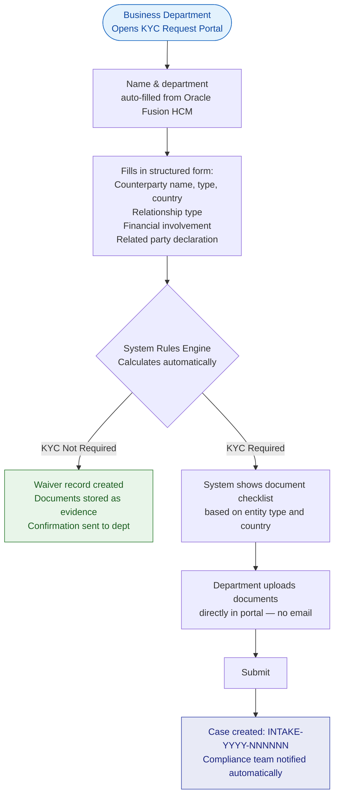
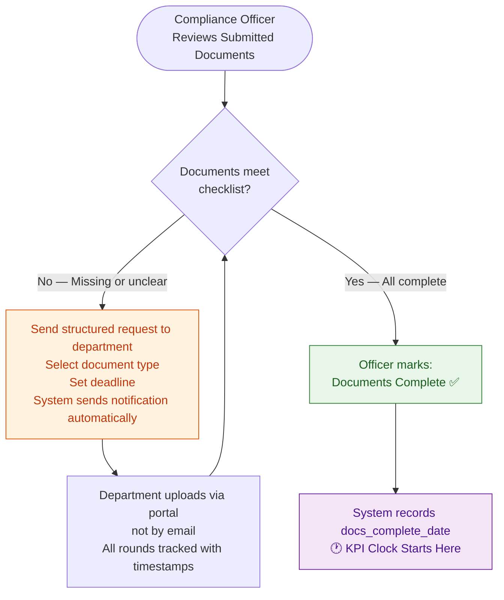
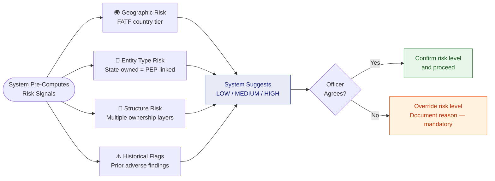
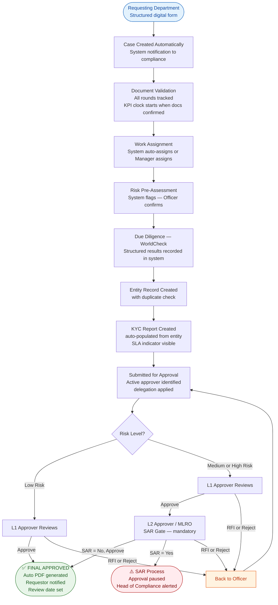

# Version 3 — Business Process Guide
# Best Practice KYC Process

**Document Type:** Business Process Guide  
**Audience:** Compliance Team, Management, Internal Auditors, Regulators  
**Standards:** FATF 40 Recommendations | Basel KYC | EU 6AMLD (as benchmark) | ISO 31000  
**Note on EU 6AMLD:** The Sixth Anti-Money Laundering Directive is an EU instrument. It is referenced here as an international best-practice benchmark, not as a binding regulatory obligation. Qatari Diar applies these standards where they represent the current global compliance standard and where they govern relationships with European counterparties or subsidiaries.  
**Status:** Target operating model — design for next-generation system  

---

## Why This Redesign?

The requirements gathering session identified that the current process relies too heavily on individual memory, email threads, and personal judgment. This creates inconsistency, audit gaps, and significant operational risk.

This redesigned process achieves four things:
1. **Replaces manual steps** with system-enforced controls wherever the decision is rule-based
2. **Preserves human judgment** for the steps that genuinely require expertise
3. **Creates a complete evidence trail** that satisfies regulatory examination
4. **Gives management visibility** without needing to request data extracts

---

## The Seven Principles This Process Upholds

Every step in this process is designed around seven core compliance principles:

1. **Know Who You Are Dealing With** — Identity verified, ownership traced
2. **Assess the Risk** — Risk level determined systematically, not just by feel
3. **Match the Effort to the Risk** — More scrutiny for higher-risk counterparties
4. **Two Pairs of Eyes** — No single person approves their own work
5. **Leave a Trail** — Every action documented, timestamped, and attributable
6. **Protect the Evidence** — Documents stored properly, not on someone's laptop
7. **Keep It Current** — KYCs reviewed regularly, not just once

---

## Complete To-Be Process — One Page

---

## The Improved Process: Phase by Phase

---

### Phase 0: Standardised Digital Intake

**What changes:** Business departments no longer send emails in any format they like. Instead, they complete a **structured digital intake form** in the system.

**How it works:**

**What this fixes:**
- Every request is in the same format, regardless of which department sends it
- When KYC is not required, there is a permanent evidence record — not just a forgotten email
- The documents are attached to the case from the very beginning — no local folders

---

### Phase 1: Document Validation — System-Assisted

**What changes:** The compliance team uses a structured checklist rather than relying on experience and memory. The system tracks how many rounds of document requests happen.

**The KPI start point** is the moment the compliance team confirms they have everything they need. Turnaround time is measured from here — not from the first email the department sent — because the compliance team cannot be held accountable for the department's delay in providing documents.

**Duplicate check:**  
When the officer is about to create an entity, the system automatically searches for similar names. If the same company was screened before, the officer is shown the previous record and can choose to link to it, rather than creating a duplicate.

---

### Phase 2: Risk Pre-Assessment

**What is new:** Before the compliance officer begins their research, the system shows them a **risk indicator panel** — a summary of automated risk signals computed from the data already provided.

This does not replace the officer's judgment — it gives them a structured starting point and ensures that obvious risk factors are never overlooked.

**Risk determines the path:**
- **Low risk** → Simplified Due Diligence (one approval required)
- **Medium risk** → Standard KYC (two approvals required)
- **High risk** → Enhanced Due Diligence (two approvals + mandatory additional fields)

---

### Phase 3: Due Diligence Research — Structured Evidence Recording

**What changes:** The screening itself continues to be conducted manually using WorldCheck (or equivalent databases). The change is in how results are **recorded** in the system.

Instead of a free-text box, the officer completes structured fields for each entity and each UBO:

| What is recorded | Example |
|---|---|
| Date screening was performed | 15 June 2025 |
| Which database(s) were checked | WorldCheck (Refinitiv) |
| Reference number from screening tool | WC-2025-123456 |
| Match status | Potential Match / No Match / Confirmed Match / False Positive |
| PEP flag | Yes / No |
| Adverse media flag | Yes / No |
| Findings narrative | Free text — what was found |
| Resolution note | If false positive: why it was dismissed |

**Why this matters:** If a regulator asks "when did you last screen ABC Company, and what did you find?", the answer is in the record — not in someone's email archive.

**Escalation rule:** If a confirmed match or PEP flag is recorded, the system automatically activates Enhanced Due Diligence requirements, regardless of what was initially selected.

---

### Phase 4 & 5: Entity and Report Creation — No Duplicate Entry

**What changes:** When the officer creates a KYC report after creating the entity, the system automatically copies across the data that was already entered. The officer verifies and enriches — they do not retype.

**New mandatory fields for Enhanced KYC:**
- Source of funds — where does the counterparty's money come from?
- Source of wealth — how did they accumulate their assets?

These are required by international standards for high-risk counterparties and cannot be skipped when Enhanced KYC is selected.

**Conclusion templates in the system:**  
Standard conclusion texts are stored in the system by risk category. The officer selects the appropriate template, which appears pre-filled in the conclusion field, ready to be personalised. No more opening Word documents.

**Date validation:**  
The system will not accept:
- Future dates in any date field
- Invalid day/month combinations (no 32nd of the 13th month)
- Request dates more than 2 years in the past (flags a warning)

**SLA indicator:**  
Every report shows a traffic-light indicator: how many days have elapsed versus the target completion time for that report type.

| KYC Type | Target Completion |
|---|---|
| Simplified | 5 business days |
| Standard | 10 business days |
| Enhanced | 20 business days |

---

### Phase 6: Level 1 Approval — With Delegation

**What changes:**

1. **Delegation is pre-configured**, not ad-hoc. If the Level 1 Approver marks themselves as on leave, the system automatically routes new submissions to their designated deputy — no phone calls needed.

2. **Structured screening results** are visible to the approver in a clear format — not buried in a free-text narrative.

3. **SLA indicator** shows the approver if a report is approaching or past its target completion time.

The three approval actions remain the same: Approve / Request For Information / Reject.

For **RFI**, the approver selects a category (Missing Document / Unclear Conclusion / Insufficient Screening / Other) before entering their comment. This helps analyse why RFIs are happening and whether they can be prevented.

---

### Phase 7: Level 2 / MLRO Approval — With SAR Gate

**What is new:** Before the Level 2 Approver makes their decision, the system asks one additional question:

> *"Based on your review of this report, is there any information that may require a Suspicious Activity Report (SAR)?"*

This is a mandatory step. If the answer is yes, the approval is paused and the Head of Compliance is alerted. The SAR process runs separately. If the answer is no, the approval proceeds normally.

This gate ensures that the compliance head consciously considers their SAR obligation on every high-risk case — it cannot be overlooked.

---

### Phase 8: Completion — Automated and Monitored

**What changes:**

**On final approval:**
- The system automatically generates the completed KYC report as a PDF
- The requesting department receives an email with the report attached — no manual follow-up needed
- The record is sealed (read-only)
- A next review date is set automatically based on risk level: **12 months** for High risk, **24 months** for Medium risk, **36 months** for Low risk

**Ongoing monitoring:**
- **60 days before** a KYC is due for review: compliance officer notified
- **On the review date** (if not yet renewed): manager notified
- **SLA breaches** on open reports: flagged to manager daily

**Live KPI Dashboard — replaces "Madi, send me an export":**

The dashboard shows in real time:
- Total KYCs completed this month / quarter / year
- Average turnaround time
- SLA compliance rate
- Reports by risk level
- Reports by contributor (team productivity)
- Pending pipeline (what is in each stage right now)
- Overdue cases

---

## The Improved Approval Process

---

## What Changes for Each Person

### For Requesting Departments
- Use a simple web form instead of sending emails
- Upload documents in one place
- Receive automatic confirmation and tracking
- Get notified automatically when the KYC is complete

### For Compliance Officers
- No more email triage — requests arrive in a structured queue
- Duplicate check happens automatically
- No double-entry between entity and report
- Conclusion templates are in the system
- SLA indicator keeps the workload visible
- Documents stay with the case — no more local folders

### For Approvers
- Delegation is pre-configured — no disruption when on leave
- Screening results presented clearly, not in a text wall
- SAR obligation is prompted explicitly for senior reviewers

### For Management
- Live dashboard — no data exports needed
- Overdue cases flagged automatically
- Team performance visible in real time
- Periodic review schedule enforced by system, not memory
