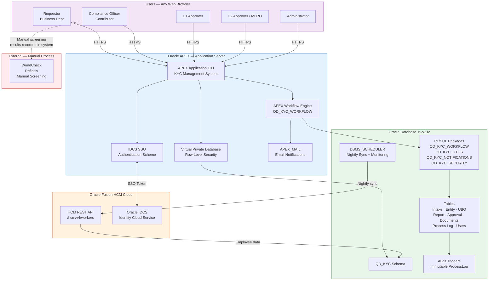
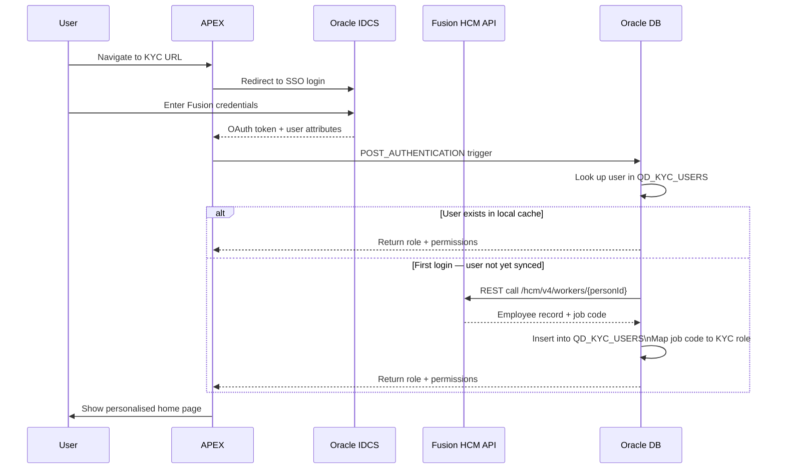
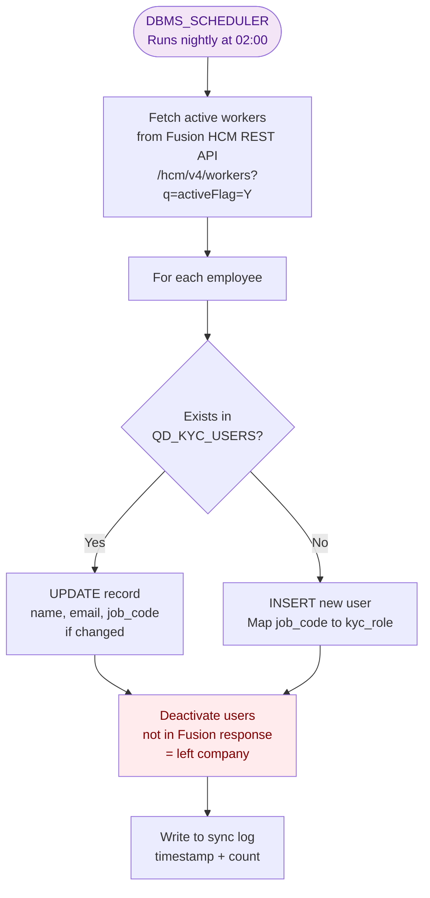
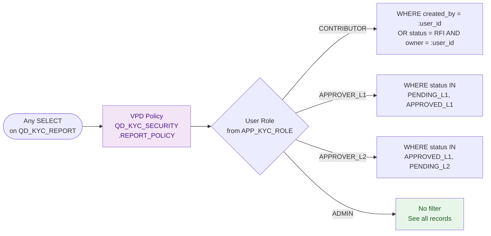

# Oracle APEX System Architecture

The technical architecture of the target KYC system built on Oracle APEX with Oracle Fusion HCM integration.

!!! tip "How to edit this diagram"
    1. Go to [diagrams.net](https://app.diagrams.net)
    2. Open via **File → Open from → GitHub**
    3. Navigate to `docs/diagrams/drawio/apex-architecture.drawio`
    4. Edit visually and save — it commits directly to GitHub
    5. Netlify rebuilds and this page updates automatically

---

## System Architecture Overview

---

## Authentication & User Provisioning Flow

---

## Nightly Sync Process

---

## Security Model — VPD Row-Level Security

---

## Application Page Structure

| Page Group | Page Numbers | Audience |
|---|---|---|
| Public / Auth | 101 (Login), 9999 (Error) | All |
| Requestor Portal | 70–79 | Requestors |
| Compliance Worklist | 1–19 | Contributors |
| Entity Management | 20–29 | Contributors |
| KYC Report | 10–19 | Contributors |
| L1 Approval Queue | 30–39 | Approvers L1 |
| L2 Approval Queue | 40–49 | Approvers L2 |
| Administration | 80–89 | Administrators |
| Executive Dashboard | 90–99 | Admins + Management |

---

## Technology Stack

| Layer | Technology | Version |
|---|---|---|
| Application | Oracle APEX | 23.2+ |
| Database | Oracle Database | 19c / 21c |
| Authentication | Oracle IDCS SSO | — |
| User Source | Oracle Fusion HCM Cloud | REST API v4 |
| Email | APEX_MAIL (SMTP) | — |
| Fuzzy Matching | UTL_MATCH.JARO_WINKLER_SIMILARITY | Built-in |
| Row Security | DBMS_RLS (VPD) | Built-in |
| Scheduling | DBMS_SCHEDULER | Built-in |
| Workflow | APEX_WORKFLOW | APEX 23.2+ |
