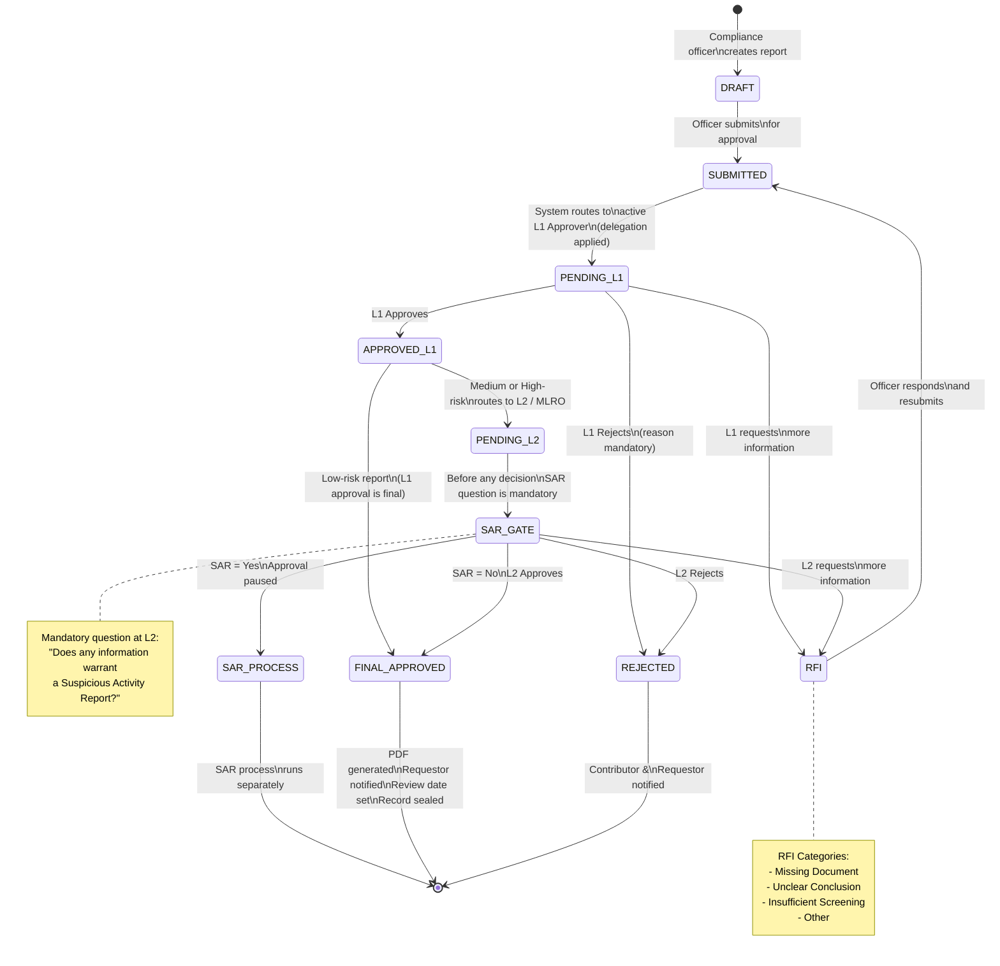
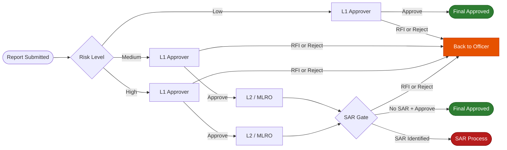
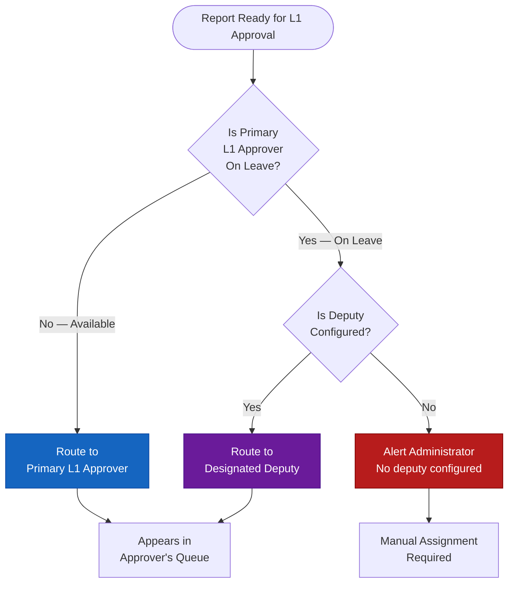

# Approval Workflow — State Machine

The complete workflow for a KYC report from creation through to final approval.

---

## State Machine

---

## Routing Rules

---

## Delegation — Active Approver Resolution

---

## All Workflow States

| State | Who Can Act | Available Actions |
|---|---|---|
| `DRAFT` | Contributor (owner only) | Edit, Submit for Approval |
| `SUBMITTED / PENDING_L1` | L1 Approver | Approve, RFI, Reject |
| `RFI` | Contributor (owner only) | Edit, Resubmit |
| `APPROVED_L1` | System (auto-routes) | — |
| `PENDING_L2` | L2 / MLRO | SAR Gate → Approve, RFI, Reject |
| `FINAL_APPROVED` | Read-only | View, Download PDF |
| `REJECTED` | Read-only | View history |

!!! note "Four-Eyes Principle"
    A contributor **cannot** approve their own submission. This is enforced at the database level — the system checks that the approver's user ID differs from the contributor's user ID before allowing any approval action.
