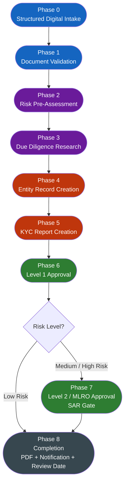
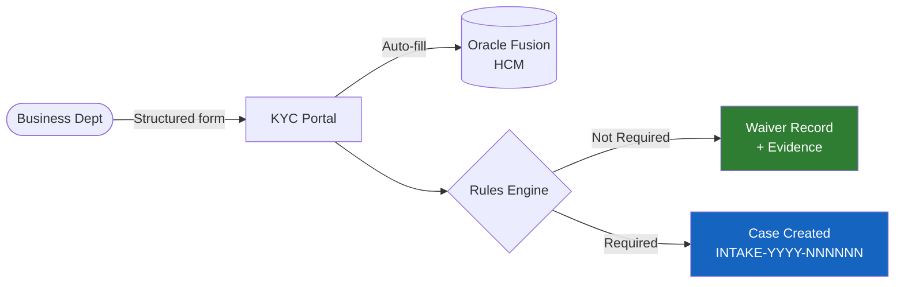
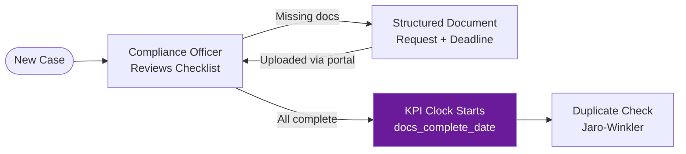
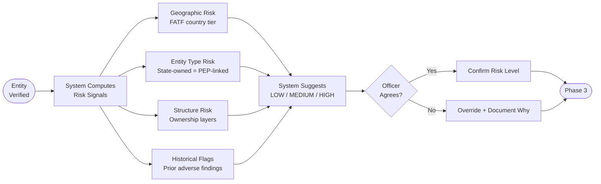
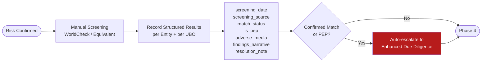
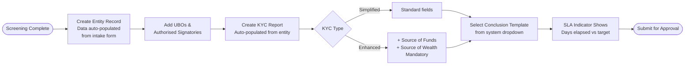
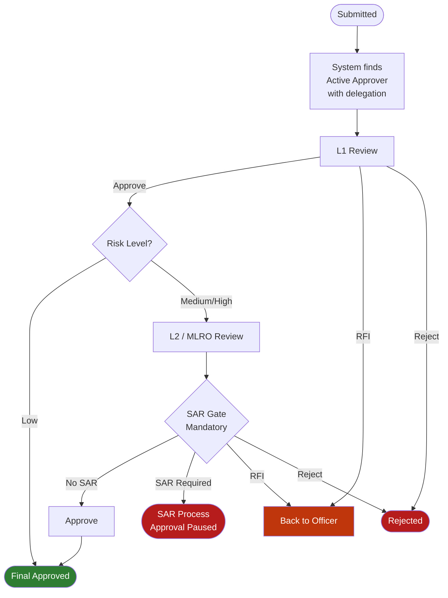
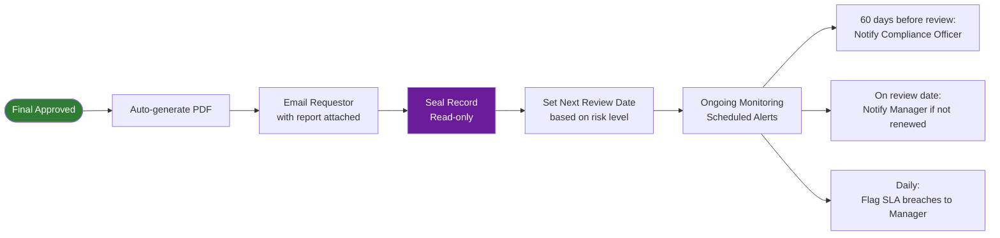

# Best Practice — End-to-End Process

The complete redesigned KYC process across all 8 phases, aligned to FATF 40 Recommendations, Basel KYC Guidelines, and EU 6AMLD.

---

## High-Level Process Map

---

## Phase Detail

### Phase 0 — Structured Digital Intake

### Phase 1 — Document Validation

### Phase 2 — Risk Pre-Assessment

### Phase 3 — Due Diligence Research

### Phases 4 & 5 — Entity & Report Creation

### Phase 6 & 7 — Approval

### Phase 8 — Completion & Ongoing Monitoring

---

## What Changes for Each Person

| Role | Before | After |
|---|---|---|
| **Requesting Dept** | Email in any format, no tracking | Structured web form, automatic confirmation, live tracking |
| **Compliance Officer** | Email triage, local folders, copy-paste | Structured queue, no re-typing, SLA visible, documents in system |
| **L1 Approver** | Ad-hoc delegation calls | Pre-configured deputy, clear screening results, delegation automatic |
| **L2 / MLRO** | Same as L1 | Plus mandatory SAR gate — cannot be skipped |
| **Management** | Excel data exports on request | Live dashboard, overdue cases flagged automatically |
