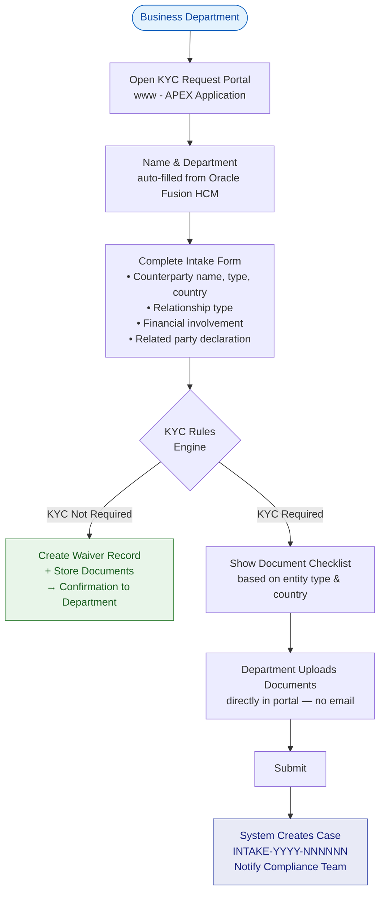
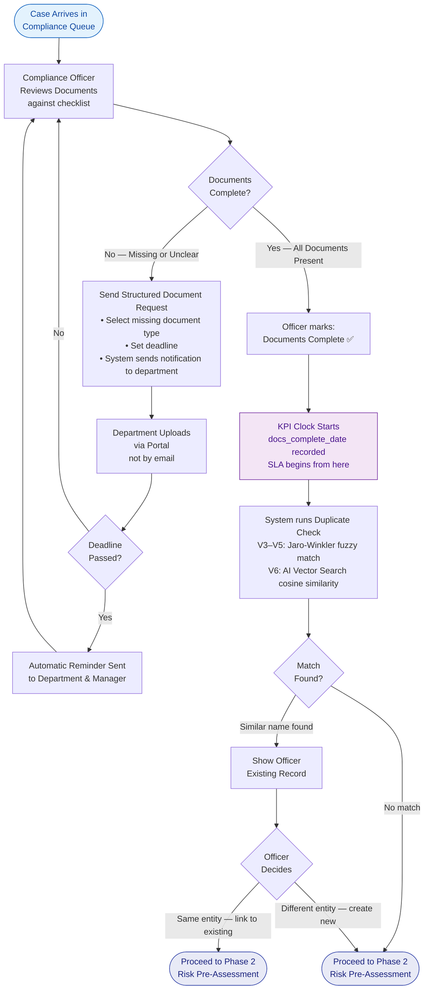

# Intake & Document Validation Flow

Covers Phase 0 (Request Intake) and Phase 1 (Document Validation) of the KYC process.

!!! tip "How to edit this diagram"
    1. Go to [diagrams.net](https://app.diagrams.net)
    2. Open via **File → Open from → GitHub**
    3. Navigate to `docs/diagrams/drawio/intake-flow.drawio`
    4. Edit visually and save — it commits directly to GitHub
    5. Netlify rebuilds and this page updates automatically

---

## Phase 0 — Structured Digital Intake

---

## Phase 1 — Document Validation

---

## KPI Note

!!! important "KPI Clock Start Point"

    The turnaround time SLA is measured from `docs_complete_date` — the moment the compliance officer confirms all documents are present and correct.

    It is **not** measured from when the department first sent their email or submitted the form. The compliance team cannot be held accountable for delays in the department providing documentation.

    | KYC Type | SLA Target |
    |---|---|
    | Simplified | 5 business days |
    | Standard | 10 business days |
    | Enhanced | 20 business days |
