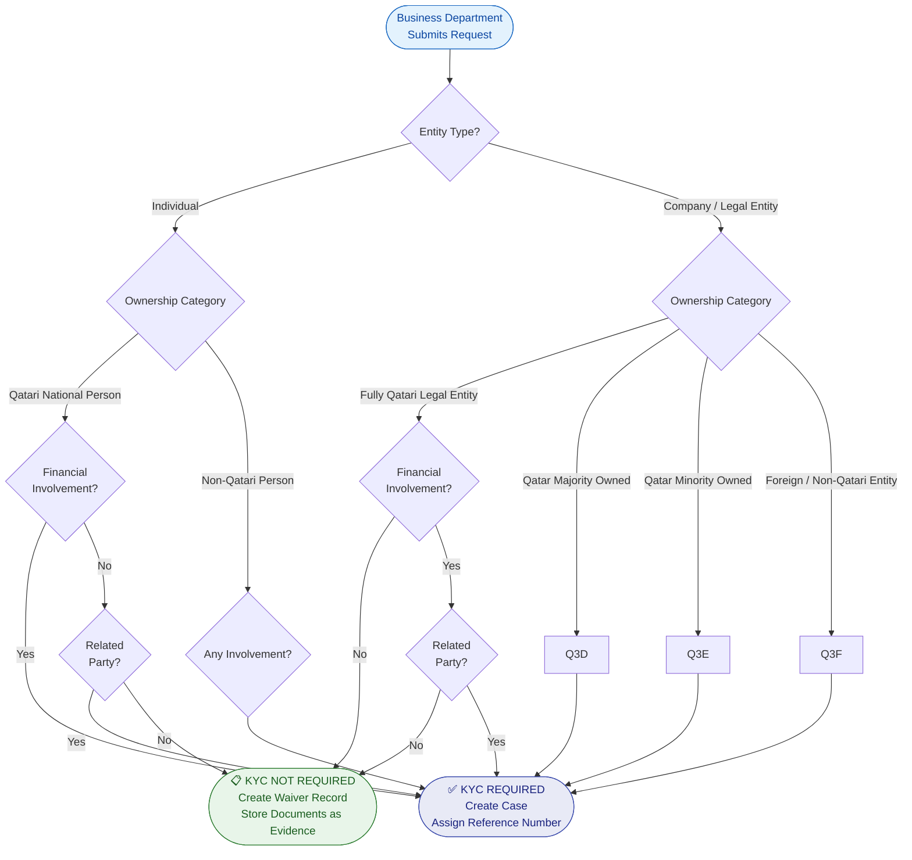

# KYC Necessity Decision

This diagram shows the rules engine that determines whether a full KYC report is required or whether a simplified waiver record is sufficient.

!!! info "This replaces the Excel calculator used in the current process."

!!! tip "How to edit this diagram"
    1. Go to [diagrams.net](https://app.diagrams.net)
    2. Click **Extras → Edit Diagram** or open via **File → Open from → GitHub**
    3. Navigate to `docs/diagrams/drawio/kyc-necessity.drawio`
    4. Edit visually and save — it commits directly to GitHub
    5. Netlify rebuilds and this page updates automatically

---

## Detail

---

## Ownership Categories

| Category | Code | Description |
|---|---|---|
| Fully Qatari Legal Entity | QLE-FULL | 100% Qatari-owned company |
| Qatar Majority Owned | QLE-MAJ | >50% Qatari ownership |
| Qatar Minority Owned | QLE-MIN | <50% Qatari ownership |
| Foreign / Non-Qatari Entity | FOREIGN | No Qatari ownership |
| Qatari National Person | QNP | Individual with Qatari nationality |
| Non-Qatari Person | NQP | Individual without Qatari nationality |

---

## Outcome Actions

=== "KYC Required"

    1. System creates a case with a unique reference number (`INTAKE-YYYY-NNNNNN`)
    2. Business department proceeds to document upload
    3. Case enters the compliance queue automatically
    4. Compliance officer is notified

=== "KYC Not Required"

    1. System creates a **waiver record** — not just a dismissal
    2. All submitted documents are attached to the waiver record as evidence
    3. Business department receives a confirmation with the waiver reference
    4. Record is retained for audit purposes (5-year minimum)

!!! warning "Important"
    Even when KYC is **not required**, a permanent evidence record is created. This satisfies the regulatory obligation to show that the determination was made consciously and documented.
