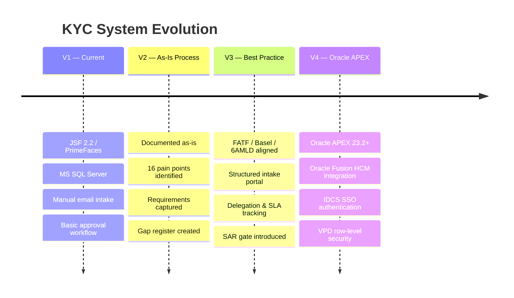

# KYC Management System — Documentation

**Organisation:** Qatari Diar Real Estate Investment Company  
**System:** Know Your Customer (KYC) Management System  
**Last Updated:** June 2026

---

## What Is This Documentation?

This site is the single source of truth for the QD KYC Management System. It covers four versions of the system — from the current application in production to the target design built on Oracle APEX — and is written for three audiences.

=== "Business & Management"

    Start with the **Business Guides** tab.

    Plain-language explanations of how the system works, what the process looks like, and what each role does. No technical knowledge needed.

    👉 [V1 — What the current system does](business/v1-current-system.md)  
    👉 [V2 — How the process works today](business/v2-asis-process.md)  
    👉 [V3 — How the process should work](business/v3-best-practice.md)  
    👉 [V4 — The new Oracle APEX system](business/v4-apex-userguide.md)

=== "IT & Developers"

    Start with the **Technical Specifications** tab.

    Detailed functional requirements, data models, API specifications, PL/SQL packages, and acceptance criteria for each version.

    👉 [V1 — Current system technical spec](technical/v1-current-system-spec.md)  
    👉 [V2 — As-is functional requirements](technical/v2-asis-requirements.md)  
    👉 [V3 — Best practice system requirements](technical/v3-best-practice-spec.md)  
    👉 [V4 — Oracle APEX developer specification](technical/v4-apex-spec.md)

=== "Compliance & Audit"

    Start with the **Compliance** tab.

    Structured gap analysis against FATF, Basel, and EU 6AMLD standards. Includes a prioritised remediation roadmap.

    👉 [FATF / Basel / 6AMLD Gap Analysis](compliance/gap-analysis.md)

---

## Version Overview

---

## Document Map

| Version | Business Guide | Technical Specification |
|---|---|---|
| **V1** — Current System | [Business Overview](business/v1-current-system.md) | [Technical Spec](technical/v1-current-system-spec.md) |
| **V2** — As-Is Process | [Process Guide](business/v2-asis-process.md) | [Requirements Spec](technical/v2-asis-requirements.md) |
| **V3** — Best Practice | [Best Practice Guide](business/v3-best-practice.md) | [System Requirements](technical/v3-best-practice-spec.md) |
| **V4** — Oracle APEX | [User Guide](business/v4-apex-userguide.md) | [APEX Developer Spec](technical/v4-apex-spec.md) |

---

## Regulatory Standards Applied

!!! info "Standards Referenced"

    - **FATF 40 Recommendations** (2023 update) — Financial Action Task Force
    - **Basel Committee KYC Guidelines** — Sound Practices for Managing Risks
    - **EU 6AMLD** — Sixth Anti-Money Laundering Directive
    - **ISO 31000** — Risk Management Principles and Guidelines

---

## Process Diagrams

All key process flows are available as interactive diagrams:

- [KYC Necessity Decision Tree](diagrams/kyc-necessity.md)
- [Intake & Document Validation Flow](diagrams/intake-flow.md)
- [Approval Workflow State Machine](diagrams/approval-workflow.md)
- [Best Practice End-to-End Process](diagrams/best-practice-e2e.md)
- [Oracle APEX System Architecture](diagrams/apex-architecture.md)
